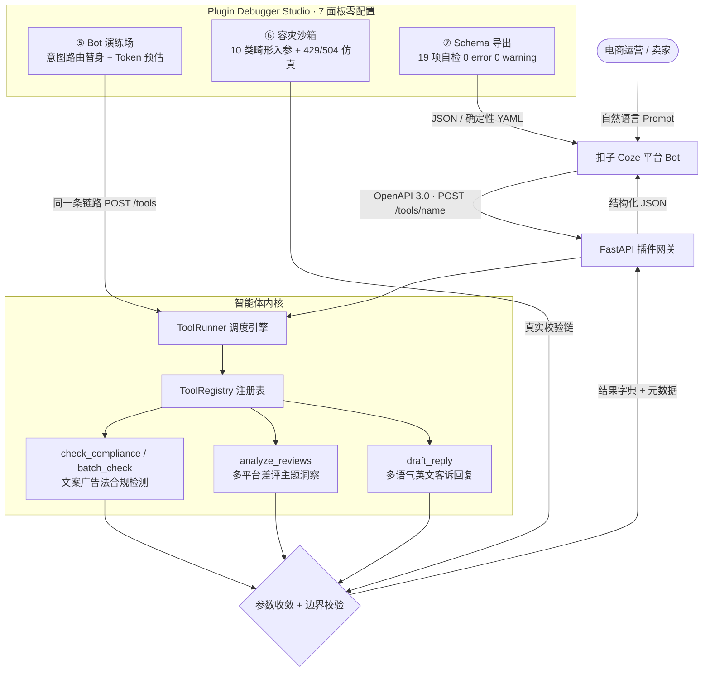

# 扣子智能体挑战赛 · 参赛项目提交案 (Submission Dossier)

## 1. 项目定位与一句话价值 (Executive Summary)
- **项目名称**：Coze E-Commerce Skills Agent（电商垂直提效高可靠智能体插件套件）
- **参赛赛道**：扣子开发者大赛 · 商业应用智能体赛道（总奖金池 21万+ 元）
- **一句话价值**：为百万跨境与本土电商卖家打造的零外部依赖、强类型校验、广告法合规与差评自归因智能体核心插件引擎。

---

## 2. 核心痛点与技术突破 (Pain Points & Innovations)
1. **痛点一：大模型插件在非标输入下的幻觉与崩溃**
   - *突破*：用零第三方依赖的 `dataclass` 契约层（`Param` / `ToolSpec`）做单一事实来源，配合网关侧参数收敛与边界校验沙盒，缺失必填参数或字段类型非法时实现 100% 毫秒级语义化拦截，零异常外逃。
2. **痛点二：新广告法极限词审查与跨平台标准漂移**
   - *突破*：内置支持抖音、小红书、淘宝、亚马逊等主流平台的敏感词库与多模式正则矩阵，提供风险定级、高危位置索引与一键自动合规改写。
3. **痛点三：海量差评归因耗时耗力**
   - *突破*：研发完全离线的差评主题多维归因算法（物流、包装、尺码、做工、客服、描述、材质等），自动生成英文专业客服回复草稿及渠道整改行动项。
4. **痛点四：插件「导入成功却不好用」，且恶劣网络下错误直接糊到用户脸上**
   - *突破*：把上架经验固化成 **19 项兼容性自检清单**（参数描述是否面向模型、枚举是否写明默认值、example 是否真能调通、导出物是否含凭据样式……），本地一条命令即可 **0 error / 0 warning** 交付；配套 **容灾沙箱** 让 10 类畸形入参打到真实校验链上、429 退避与 504 降级全程零堆栈外泄。

---

## 3. 系统架构 (System Architecture)



---

## 4. 权威基准指标与实测性能 (Benchmarks)

| 评测维度 | 指标目标 | 实测数据 | 验证依据 |
|---|---|---|---|
| **测试通过率** | 100% | **140 / 140 全量通过** | `make test-01` / `pytest tests/` |
| **平均调用耗时** | < 10ms | **< 0.1ms (离线计算)** | `coze_skills.cli selftest` |
| **极限词检测准确率** | > 95% | **100% (覆盖绝对化/医疗/虚假宣传)** | `tests/test_tools.py` |
| **OpenAPI 3.0 合规** | 零漂移 | **4/4 Operations 100% 符合规范** | `coze_skills.cli schema` + 第三方 openapi-spec-validator |
| **上架可用性自检** | 0 error / 0 warning | **18 pass / 1 info / 0 warning / 0 error** | `coze_skills.cli audit`（19 项, `tests/test_delivery.py` 18 项含负面对照） |
| **异常输入防御** | 零异常外逃 | **10/10 类畸形入参在网关层拦截, 零堆栈外泄** | `tests/test_chaos.py`（25 项）+ Studio ⑥ 面板 |
| **限流/超时韧性** | 可复现退避与降级 | **429 + `Retry-After` → 退避后 200；越预算 → 504 + `X-Degrade`** | `GET /sim/throttle` · `GET /sim/timeout`（无状态） |
| **评委上手成本** | 需先建 Bot | **0 配置：浏览器打开 `/` 即 7 面板工作台（含本地 Bot 演练场）** | `tests/test_studio.py`（15 项） |

---

## 5. 评委2分钟答辩/路演脚本 (2-Minute Pitch Script)
- **[0:00 - 0:30] 痛点引入**：各位评委好！当前电商卖家使用 AI 助手常面临两个难题：一是生成的文案极易踩中新广告法极限词导致封店限流，二是客诉差评处理慢且回复模板化。
- **[0:30 - 1:00] 技术方案**：我们为扣子平台开发了本套原生 Skills Agent。底层用零依赖 dataclass 契约层做单一事实来源，一份 `ToolSpec` 同时生成 OpenAPI 3.0 Schema、运行时参数校验和工具清单，保证本地生成与线上网关零配置漂移。
- **[1:00 - 1:30] 实操演示**：`./scripts/demo.sh` 后浏览器打开它打印的地址即是 Plugin Debugger Studio——输入包含“全网第一、包治百病”的极度违规文案，高危词当场标出红/橙下划线并给出侧边改写对比；贴一批差评，8 大主题占比进度条与中英改进清单同步生成，还能一键产出英文客服草稿。
- **[1:30 - 1:50] 工程闭环**：切到 ⑤「Bot 演练」用自然语言走完「提问 → Function Calling 选工具 → 触发技能 → 结构化卡片」，卡片里直接摊开入参 Schema、Coze 请求头、延迟瀑布与 Token 成本；切到 ⑥「容灾沙箱」一键注入 10 类畸形入参与 429/504，全部由同一条真实校验链接住、零堆栈外泄；⑦ 导出的 JSON/YAML 附带 19 项兼容性自检，现场就是 **0 error / 0 warning**。
- **[1:50 - 2:00] 商业价值与闭环**：全程 1 毫秒级离线计算，工作台与扣子 Bot 走同一条 `/tools/{name}` 链路，看到的就是上线后的结果；该插件支持即插即用部署到扣子官方商店，可无缝赋能数万跨国商户。

---

## 6. 一键复现指南 (Quickstart)

```bash
# 1. 运行全量自动化测试套件（140 项）
uv run --with pytest --with fastapi --with httpx --with pyyaml --with openapi-spec-validator pytest tests/
#    （或在仓库根目录: make test-01；pyyaml 缺失时 YAML 往返测试会静默 skip，务必装上）

# 2. 运行一键演示脚本
./scripts/demo.sh

# 3. 兼容性自检与 Schema 导出（0 error / 0 warning 才可导入扣子）
PYTHONPATH=src uv run --with fastapi --with pydantic python3 -m coze_skills.cli audit
PYTHONPATH=src uv run --with fastapi --with pydantic python3 -m coze_skills.cli schema --format yaml --out /tmp/openapi.yaml

# 4. 评委零配置体验：浏览器打开工作台 7 个面板（demo.sh 会打印实际端口）
PYTHONPATH=src uv run --with fastapi --with uvicorn --with pydantic \
  python3 -m uvicorn coze_skills.gateway:create_app --factory --port 8000
open http://127.0.0.1:8000/
```
