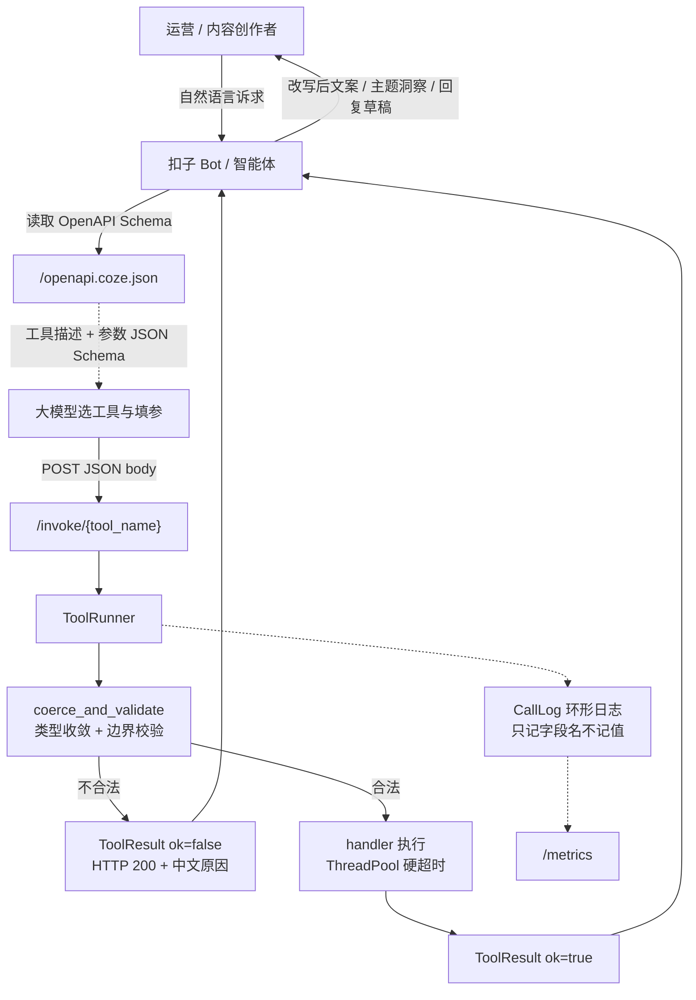

# 核心架构与算法说明

> 项目：扣子 (Coze) AI 智能体与技能共创挑战赛 · 垂类提效插件集
> 代码位置：`src/coze_skills/`

## 1. 核心业务流程图



## 2. 三层解耦设计

| 层 | 文件 | 职责 | 关键约束 |
|---|---|---|---|
| 契约层 | `core/spec.py` | `Param` / `ToolSpec` / `ToolResult` / `ToolError` | 零第三方依赖（仅标准库），可跑在最小镜像 |
| 生成层 | `core/schema.py` | ToolSpec → OpenAPI 3.0 文档 + 本地结构自检 | 输出 `sort_keys` 稳定，中文不转义 |
| 执行层 | `core/runner.py` | 参数收敛校验、超时、异常兜底、调用日志 | `invoke` **永不抛异常**，全路径返回 `ToolResult` |
| 网关层 | `core/server.py` | FastAPI 路由、健康检查、指标 | 业务错误统一 `HTTP 200 + ok=false` |
| 工具层 | `tools/*.py` | 垂类业务实现 | 只暴露模块级 `TOOLS`，不感知 HTTP/Coze |

**关键决策：为什么 `tools/` 不 import `core/` 之外的东西？**
因为 `registry.discover()` 用 `importlib` 扫描 `coze_skills.tools.*`，工具模块一旦反向依赖网关就会形成循环导入。所有跨层能力（校验、日志、超时）都由 `ToolRunner` 统一注入，工具实现体内不再出现 `isinstance` 判断。

**为什么不用 `@app.on_event`？** FastAPI 0.110+ 已废弃，改用 `lifespan` 上下文管理器，避免启动期 DeprecationWarning 污染容器日志。

## 3. 核心算法

### 3.1 合规检测（`tools/text_compliance.py`）

词库分五类、两级严重度：

| 类别 | 严重度 | 示例 |
|---|---|---|
| 绝对化用语 | high | 国家级、世界级、第一、全网第一 |
| 医疗功效 | high | 治疗、根治、脱发再生 |
| 金融合规 | high | 稳赚、保本、无风险 |
| 极限词正则 | medium | `最[低价好优劣佳]`、`第[0-9一二三四五六七八九十]+名` |
| 平台软性词 | medium | 超值、爆款、限时秒杀 |

- 整体风险等级：命中任一 high 类 → `high`；仅命中 medium → `medium`；无命中 → `low`。
- 同词多处命中只报一次，附全部 `positions`，同时给出**合规改写建议**与 `rewritten_text`（可直接替换上线）。
- 平台差异通过 `platform` 参数（`xhs`/`douyin`/`taobao`/`amazon`/`general`）控制软性词宽松度。
- 批量模式 `batch_check` 保证结果与输入**等长同序**，运营可直接回填原表。

### 3.2 差评洞察（`tools/review_insight.py`）

纯本地启发式，**零网络依赖**，保证离线与断网环境可跑：

1. **归一化**：中英混排文本统一小写、去停用词。
2. **多标签归因**：一条差评可命中多个主题（如「包装破了而且物流慢」同时计入包装破损与物流时效），主题表覆盖物流时效/包装破损/尺寸偏差/质量做工/客服响应/描述不符/价格价值/气味材质。
3. **排序确定性**：按 `count` 降序，**平局按主题名排序** —— 这是可测试性的前提，`test_analyze_reviews_ranks_themes_and_actions` 断言两次调用结果完全一致。
4. **输出**：主题分布 + `negative_ratio` + 每主题最多 2 条原文摘录（截断 80 字符，防撑爆模型上下文）+ 中文可执行改进建议。

### 3.3 回复草稿（`draft_reply`）

- 主主题归因 → 决定 `apology_level`（物流/质量/包装 → high，其余 medium；`refund_ready=true` 升一级但不越界）。
- 三种语气（`professional`/`friendly`/`concise`）走不同模板，实测字数 95 / 104 / 46，风格可区分。
- **硬性契约**：草稿必须始终包含 `{{support_email}}` 占位符，供 Bot 侧二次替换，避免把真实客服邮箱硬编码进模板。

## 4. 技术选型理由

| 选型 | 理由 | 被否方案 |
|---|---|---|
| 统一 `POST + JSON body` | Coze 对 body 传参支持最完整，避免 query 编码歧义（中文文案必转义） | GET + query：长文案会超 URL 长度限制 |
| 业务错误返回 `HTTP 200 + ok=false` | 非 2xx 会被 Coze 判定为网络故障并触发重试，放大下游压力 | 4xx/5xx：触发平台重试风暴 |
| 参数级类型收敛（`Param.coerce`） | 大模型高频传 `"3"` / `"true"` 字符串，在网关层统一纠偏 | 每个工具各写 `int(x or 1)`：重复且易漏 |
| `ThreadPoolExecutor` 单次提交实现硬超时 | 网关可能跑在非主线程，`signal.alarm` 在子线程不可用 | `signal`：非主线程崩溃 |
| 零依赖契约层 | 网关镜像只装 fastapi/uvicorn 两个包，冷启动秒级 | pydantic 建模：为 4 个工具拖入重依赖 |
| 词库/主题表内联为常量 | 离线可跑、可测试、无需运维维护外部配置文件 | 外部 yaml/DB：多一份部署故障点 |

## 5. 统一响应契约

所有接口（含失败）返回同一结构，Bot 侧只需判断 `ok`：

```json
{ "ok": true, "error": null, "data": { "...业务字段..." } }
```

参数校验失败示例：

```json
{ "ok": false, "error": "参数校验失败: 参数 'top_n': 取值不得大于 20, 实际 999", "data": {} }
```

## 6. 可观测性

- `GET /metrics` 暴露 `CallLog.summary()`：总量、成功率、平均耗时、按工具拆分、最近 5 条失败。
- 日志**只记录参数名不记录参数值**（`CallRecord.params_keys`），避免用户文案与密钥落盘。
- 环形日志容量默认 200，长跑进程内存有界。

## 7. 验证方式

```bash
cd src
PYTHONPATH=src python3 -m pytest tests -q          # 32 个测试全绿
PYTHONPATH=src python3 -m coze_skills.cli schema --out ../docs/coze-plugin-openapi.json
PYTHONPATH=src python3 -m coze_skills.cli selftest  # 逐工具抽检参数拦截
PYTHONPATH=src python3 -m uvicorn coze_skills.core.server:create_app --factory --port 8000
```
