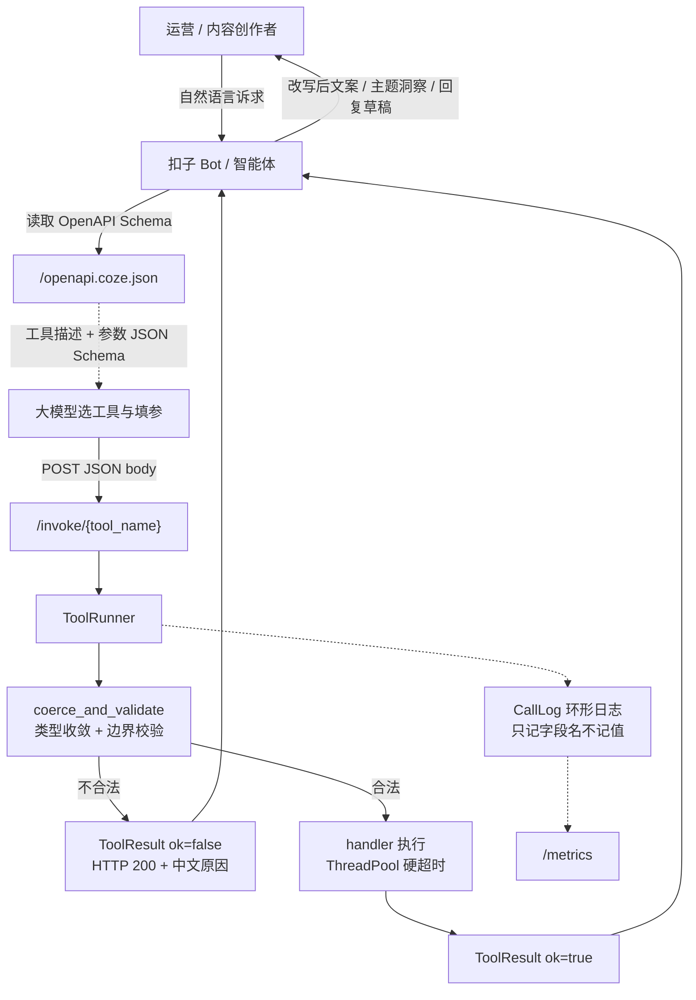

# 核心架构与算法说明

> 项目：扣子 (Coze) AI 智能体与技能共创挑战赛 · 垂类提效插件集
> 代码位置：`src/coze_skills/`

## 1. 核心业务流程图



## 2. 三层解耦设计

| 层 | 文件 | 职责 | 关键约束 |
|---|---|---|---|
| 契约层 | `core/spec.py` | `Param` / `ToolSpec` / `ToolResult` / `ToolError` | 零第三方依赖（仅标准库），可跑在最小镜像 |
| 生成层 | `core/schema.py` | ToolSpec → OpenAPI 3.0 文档 + 本地结构自检 | 输出 `sort_keys` 稳定，中文不转义 |
| 导出层 | `core/yamlout.py` | OpenAPI 文档 → YAML | **只用标准库**、可确定复现（同输入同字节），`safe_load` 回来与原 doc 相等 |
| 上架层 | `core/audit.py` | 19 项 Coze 兼容性自检清单 | 管**可用性**而非结构合法性；`info` 级不计入 warning |
| 执行层 | `core/runner.py` | 参数收敛校验、超时、异常兜底、调用日志 | `invoke` **永不抛异常**，全路径返回 `ToolResult` |
| 网关层 | `core/server.py` | FastAPI 路由、健康检查、指标 | 业务错误统一 `HTTP 200 + ok=false`；**不含任何演示面** |
| 演练层 | `core/bot.py` | 确定性意图路由 + 卡片组装 + Token 估算 | 替身只替代「大模型选工具」一跳；产出的入参仍按**不可信输入**过真实校验链 |
| 容灾层 | `core/chaos.py` | 畸形入参用例声明 + 429/504 仿真常量 | 用例单点声明（前端不另抄），仿真端点**无隐藏状态** |
| 演示层 | `gateway.py` + `static/` | Studio 7 面板（`GET /`、`/studio/*`、`/bot/*`、`/sim/*`、`/audit`、`/export/openapi`） | 前端只调 `POST /tools/{name}`，与扣子同源链路；静态资源缺失时自动降级为纯 API |
| 工具层 | `tools/*.py` | 垂类业务实现 | 只暴露模块级 `TOOLS`，不感知 HTTP/Coze |

**关键决策：为什么 `tools/` 不 import `core/` 之外的东西？**
因为 `registry.discover()` 用 `importlib` 扫描 `coze_skills.tools.*`，工具模块一旦反向依赖网关就会形成循环导入。所有跨层能力（校验、日志、超时）都由 `ToolRunner` 统一注入，工具实现体内不再出现 `isinstance` 判断。

**为什么不用 `@app.on_event`？** FastAPI 0.110+ 已废弃，改用 `lifespan` 上下文管理器，避免启动期 DeprecationWarning 污染容器日志。

## 3. 核心算法

### 3.1 合规检测（`tools/text_compliance.py`）

词库分五类、两级严重度：

| 类别 | 严重度 | 示例 |
|---|---|---|
| 绝对化用语 | high | 国家级、世界级、第一、全网第一 |
| 医疗功效 | high | 治疗、根治、脱发再生 |
| 金融合规 | high | 稳赚、保本、无风险 |
| 极限词正则 | medium | `最[低价好优劣佳]`、`第[0-9一二三四五六七八九十]+名` |
| 平台软性词 | medium | 超值、爆款、限时秒杀 |

- 整体风险等级：命中任一 high 类 → `high`；仅命中 medium → `medium`；无命中 → `low`。
- 同词多处命中只报一次，附全部 `positions`，同时给出**合规改写建议**与 `rewritten_text`（可直接替换上线）。
- 平台差异通过 `platform` 参数（`xhs`/`douyin`/`taobao`/`amazon`/`general`）控制软性词宽松度。
- 批量模式 `batch_check` 保证结果与输入**等长同序**，运营可直接回填原表。

### 3.2 差评洞察（`tools/review_insight.py`）

纯本地启发式，**零网络依赖**，保证离线与断网环境可跑：

1. **归一化**：中英混排文本统一小写、去停用词。
2. **多标签归因**：一条差评可命中多个主题（如「包装破了而且物流慢」同时计入包装破损与物流时效），主题表覆盖物流时效/包装破损/尺寸偏差/质量做工/客服响应/描述不符/价格价值/气味材质。
3. **排序确定性**：按 `count` 降序，**平局按主题名排序** —— 这是可测试性的前提，`test_analyze_reviews_ranks_themes_and_actions` 断言两次调用结果完全一致。
4. **输出**：主题分布 + `negative_ratio` + 每主题最多 2 条原文摘录（截断 80 字符，防撑爆模型上下文）+ 中文可执行改进建议。
5. **`negative_ratio` 的词表覆盖面必须与主题表同量级**：情绪词表过窄时，一整屏真实差评（「快递太慢」「盒子压烂」「偏小穿不进去」）会算出个位数负面占比，工作台与 Bot 上的结论同时失真。`test_studio.py::test_studio_demo_sample_reads_as_negative_reviews` 用工作台示例钉住这条下限（≥ 0.75）。

### 3.3 回复草稿（`draft_reply`）

- 主主题归因 → 决定 `apology_level`（物流/质量/包装 → high，其余 medium；`refund_ready=true` 升一级但不越界）。
- 三种语气（`professional`/`friendly`/`concise`）走不同模板，实测字数 95 / 104 / 46，风格可区分。
- **硬性契约**：草稿必须始终包含 `{{support_email}}` 占位符，供 Bot 侧二次替换，避免把真实客服邮箱硬编码进模板。

### 3.4 Coze Bot 演练场（`core/bot.py`）

Studio 第 ⑤ 面板要在**零外部大模型**前提下复现扣子线上「自然语言 → 选工具 → 填参 → 结构化回复」这条链路，
做法是把大模型那一跳换成确定性规则路由，换成真模型时**整层替换而接口不变**：

| 本模块 | 对应线上形态 |
|---|---|
| `route()` | Coze 的 `function_call` 决策（工具名 + arguments） |
| `run_turn()` | 工具执行 + 结果回填给模型后的卡片渲染 |
| `estimate_tokens()` | 该轮对话的 token 成本预估 |

1. **意图打分**：`INTENT_SIGNALS` 命中一个信号词 +1 分，`_score_intents` 按 `(-score, 声明序)` 排序 ——
   **同分时越具体的意图赢**（声明序 `draft_reply` → `analyze_reviews` → `batch_check` → `check_compliance`），
   所以「给这条差评写封英文回复…」判给 `draft_reply` 而不是同样命中的 `analyze_reviews`。
   这个 tie-break 写死在排序键里，不靠 `sorted` 的稳定排序巧合。
2. **口语别名映射**：用户不会照着 enum 打字名，`PLATFORM_ALIASES` / `TONE_ALIASES` 把「天猫」映射到 `taobao`、
   「虾皮」映射到 `shopee`、「别太正式」映射到 `friendly`。
3. **正文抽取三级降级**：引号内文本 → 冒号后的整行 → 去掉指令词后的残句。摘不到内容就返回 `clarify`
   而不是硬调工具——「分析这批差评」这种没带原文的指令会被明确拒绝并提示补内容，这是本地替身也必须守住的
   「不编造参数」底线。
4. **多轮追问继承**：客户端把上一轮卡片里的 `{"tool","params"}` 回传，`FOLLOWUP_SIGNALS` 命中时只改
   被点名的参数（`overrides=["platform"]`），其余沿用。**这份 context 是不可信输入**：它照样过
   `ToolRunner` 的真实校验链，被篡改的 `top_n=999` 会在网关层被挡下（`test_bot.py` 钉死这条回归）。
5. **Token 预估**：CJK 1 token/字、其余 4 字符/token（向上取整），不引 tokenizer 依赖；
   按 `context` / `prompt` / `tool_output` / `completion` 四类分账，`manifest_tokens()`（工具清单体积）
   就是每轮的成本地板。UI 据此标注「预估」而非精确计数。
6. **隐私边界**：本模块只做路由与展示、**不写日志**；调用日志仍由 `ToolRunner` 单点记录且只记参数名。
   Coze 请求头样本里的 `Authorization` **永远只是 `Bearer ${COZE_PLUGIN_TOKEN}` 占位符**，不落任何可用凭据。

### 3.5 容灾沙箱（`core/chaos.py` + `/sim/*`）

Studio 第 ⑥ 面板证明恶劣网络环境下的稳定性，三条原则：

1. **不造假数据**：10 类畸形入参（`missing-required` / `wrong-container-type` / `enum-violation` /
   `range-violation` / `empty-required` / `unknown-param` / `array-item-type` / `non-object-body` /
   `truncated-json` / `unknown-tool`）全部打到**真实的** `POST /tools/{name}`，由同一条校验链拦截，
   因此红字诊断就是线上扣子调用失败时大模型看到的原文。
2. **单一事实来源**：用例集只在 Python 声明一次，经 `GET /sim/cases` 吐给前端渲染，pytest 拿同一份断言；
   `test_studio.py` 反向钉住「用例文案不得抄进 app.js」，杜绝前端演示过了但后端早改了。
   每条用例的 `expect` 是错误原文必须包含的子串 —— 校验文案一变，测试立刻红。
3. **仿真端点无隐藏状态**：`/sim/throttle` 与 `/sim/timeout` 的结果完全由查询参数决定
   （`attempt`/`reject_times` 返回 429 + `Retry-After`，越界则 200 + `recovered_after`；
   `ms > budget` 返回 504 + `X-Degrade: cached-result`，否则 200），评委反复点也能复现。
   `ms` 封顶 5000、`attempt` 封顶 20，防止误操作把演示进程睡死；真正的中断由前端
   `AbortController` 完成，退避时长读服务端的 `Retry-After`，而不是前端硬编码。

### 3.6 上架自检与确定性导出（`core/audit.py` + `core/yamlout.py`）

`validate_openapi` 只管**结构合法性**（会不会导入失败）；上线后真正常见的是「导入成功但大模型照样选错工具、
填错参数」，于是把这类经验固化成 19 项可执行检查（参数描述 ≥10 字、工具描述 ≥30 字、枚举必须写明默认值、
超时在平台预算内、example 必须真能经 runner 调通、导出文本不含凭据样式片段等）。

- **分级口径**：`error` = 会被拒绝导入或线上必然翻车；`warning` = 能导入但显著降低调用成功率；
  `info` = 演示环境成立、上架前替换（如 `http://127.0.0.1`），**不计入 warning** —— 否则本地跑通却满屏黄字，
  反而看不清真实风险。目标 `0 error · 0 warning`。
- **负面对照**：`test_delivery.py` 构造一份「结构合法但不好用」的薄描述注册表，断言
  `validate_openapi` 照样通过而自检清单必须变红，否则这套闸门等于没装。
- **确定性 YAML**：`to_yaml` 只用标准库，`_key()` 让普通键保持可读（`openapi:`）而把保留字/数字键
  JSON 引号化（`"200":`），保证 `safe_load(to_yaml(sorted_document(doc))) == doc` 且两次生成逐字节一致 ——
  能进 git diff 才是可审计的交付物。`docs/coze-plugin-openapi.yaml` 入库即由这条守卫看着漂移。

## 4. 技术选型理由

| 选型 | 理由 | 被否方案 |
|---|---|---|
| 统一 `POST + JSON body` | Coze 对 body 传参支持最完整，避免 query 编码歧义（中文文案必转义） | GET + query：长文案会超 URL 长度限制 |
| 业务错误返回 `HTTP 200 + ok=false` | 非 2xx 会被 Coze 判定为网络故障并触发重试，放大下游压力 | 4xx/5xx：触发平台重试风暴 |
| 参数级类型收敛（`Param.coerce`） | 大模型高频传 `"3"` / `"true"` 字符串，在网关层统一纠偏 | 每个工具各写 `int(x or 1)`：重复且易漏 |
| `ThreadPoolExecutor` 单次提交实现硬超时 | 网关可能跑在非主线程，`signal.alarm` 在子线程不可用 | `signal`：非主线程崩溃 |
| 零依赖契约层 | 网关镜像只装 fastapi/uvicorn 两个包，冷启动秒级 | pydantic 建模：为 4 个工具拖入重依赖 |
| 词库/主题表内联为常量 | 离线可跑、可测试、无需运维维护外部配置文件 | 外部 yaml/DB：多一份部署故障点 |
| 演练场用确定性规则路由替身大模型 | 演示不受模型抖动影响、可逐条 pytest 钉死；换成真模型时整层替换而接口不变 | 直连大模型：现场演示看网络与配额脸色，且测试不可复现 |
| 容灾用例打到真实 `/tools/{name}` | 红字诊断即线上原文，零「演示过了但后端改了」 | 前端 mock 错误文案：验证的是一段不存在的代码 |
| 仿真端点无隐藏状态（全由 query 决定） | 评委反复点可复现，pytest 可脱离 HTTP 直接断言 | 计数器式仿真：第二次点结果就变了 |
| YAML 导出手写标准库 emitter | 逐字节可复现、能进 git diff、运行依赖仍是 2 个包 | 引 PyYAML：为一份导出物给网关加运行时依赖 |
| 自检清单把「可用性」独立成层 | 结构合法 ≠ 好用；导入成功但模型选错工具是最常见的线上事故 | 只做 `validate_openapi`：绿了却不好用 |

## 5. 统一响应契约

所有接口（含失败）返回同一结构，Bot 侧只需判断 `ok`：

```json
{ "ok": true, "error": null, "data": { "...业务字段..." } }
```

参数校验失败示例：

```json
{ "ok": false, "error": "参数校验失败: 参数 'top_n': 取值不得大于 20, 实际 999", "data": {} }
```

## 6. 可观测性

- `GET /metrics` 暴露 `CallLog.summary()`：总量、成功率、平均耗时、按工具拆分、最近 5 条失败。
- 日志**只记录参数名不记录参数值**（`CallRecord.params_keys`），避免用户文案与密钥落盘。
- 环形日志容量默认 200，长跑进程内存有界。

## 7. 验证方式

以下均在 `01_coze-skills-agent/` 根目录执行（`pytest.ini` 里 `pythonpath = src` 以根目录为基准，测试必须在根目录跑）：

```bash
python3 -m pytest tests -q                            # 140 个测试全绿（或 make test-01）
PYTHONPATH=src python3 -m coze_skills.cli schema --out docs/coze-plugin-openapi.json
PYTHONPATH=src python3 -m coze_skills.cli schema --format yaml --out docs/coze-plugin-openapi.yaml
PYTHONPATH=src python3 -m coze_skills.cli audit       # 19 项兼容性自检, 目标 0 error / 0 warning
PYTHONPATH=src python3 -m coze_skills.cli selftest    # 逐工具抽检参数拦截
PYTHONPATH=src python3 -m uvicorn coze_skills.gateway:create_app --factory --port 8000
#   ↑ 交付入口：浏览器打开 http://127.0.0.1:8000/ 即 Plugin Debugger Studio（7 个面板）
#   （只要纯 API 时换成 coze_skills.core.server:create_app）
```

演示面可脱离浏览器直接验收（`scripts/demo.sh` 第 5 步就是这么做的）：

```bash
curl -s localhost:8000/audit | head -c 200                        # 0 error / 0 warning
curl -s localhost:8000/sim/cases | python3 -c 'import json,sys; print(json.load(sys.stdin)["data"]["count"])'   # 10
curl -s -X POST localhost:8000/bot/chat -H 'Content-Type: application/json' \
  -d '{"message":"帮我看看「全网第一，包治百病」这条文案能不能发"}'   # 结构化卡片
curl -s -o /dev/null -w '%{http_code}\n' "localhost:8000/sim/throttle?attempt=0"   # 429
curl -s -o /dev/null -w '%{http_code}\n' "localhost:8000/sim/timeout?ms=3000&budget=1200"  # 504
```
