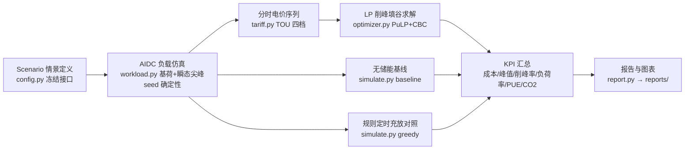

# 提交材料 · 钠电储能 × AIDC 算力中心削峰填谷智能调度

> 赛事：初焰·钠宙｜钠电 × AIDC 线上黑客松 Season 01（HackerTrip，赛事 ID `hackertrip-31ea58bc-a13b-4720-8cb6-b78701efd0ca`）
> 选题：12 个产业议题之「AIDC 数据中心瞬态算力峰值时的钠电储能削峰填谷智能调度算法」
> 本文档与代码同步演进；**所有结果数值均由运行时计算**（见 `reports/`），本文不预填任何指标。

## 1. 痛点与方案一句话

大模型训练任务造成 **15~120 分钟级瞬态算力峰值**，可把并网点功率推高至变压器/并网限额以上（极端情景下 IT+制冷负荷 12161.6 kW > 限额 8000 kW）。传统答案是变压器扩容（周期长、投资大、需量电费常年抬高）。本方案用 **电网侧钠离子储能 + 线性规划（LP）调度** 做削峰填谷：不扩变压器，用储能顶住尖峰，同时量化电费节省、需量削减与 PUE 影响。

## 2. 核心业务流程



三条策略（`baseline` / `greedy` / `optimal`）同口径对比，用以证明 LP 相对现场规则策略的**增量价值**，而非参数调出来的好看数字。

## 3. 核心算法

完整推导见 `src/optimizer.py` docstring 与 README「模型数学摘要」；此处摘录评审关注点。

**决策变量**（t = 0..95，dt = 0.25 h）：`charge[t]`、`discharge[t]`、`soc[t]`、`grid[t]`、标量 `peak`。

**目标（元/日，严格线性）**：

    min Σ_t price[t]·grid[t]·dt + peak·demand_per_kw/30 + Σ_t discharge[t]·dt·c_throughput

**关键约束**：功率平衡（含 UPS 损耗）、并网点硬限 `grid[t] ≤ grid_connection_kw − reserve`、SOC 递推（充电乘 η_c、放电除 η_d）、SOC 边界、循环日终端 `soc[95] ≥ soc_init`、峰值上界 `peak ≥ grid[t]`。

**两个算法亮点**：

1. **纯 LP、零整数变量**：η_c·η_d < 1 且吞吐成本 ≥ 0 ⇒ 同充同放必被支配，LP 顶点解自动满足互补性 `charge[t]·discharge[t] = 0`，无需 LpBinary（`tests/test_optimizer.py` 数值验证互补性与 SOC 闭环复算）。求解是多项式时间且全局最优，适合在线滚动调度。
2. **极端尖峰可行性设计**：`extreme_peak` 情景放电需求下限 = 12161.6 − 8000 = 4161.6 kW；储能按 5500 kW / 22000 kWh（≈4 h 满放，~24% 裕度）配置。默认 500 kW 储能下 LP 不可行——测试**断言这一不可行性**（`InfeasibleError`），证明限额约束真实生效而非摆设。

**PUE 模型口径**（`src/pue.py`）：`PUE = (IT + 制冷 + UPS 损耗 + 储能往返损耗) / IT`，恒 ≥ 1.0，IT=0 除零保护；制冷功率随负载率（partload COP 退化）与环境温度耦合。**诚实原则**：储能往返损耗使设施侧 PUE 略升，收益在电网侧（削峰/需量/套利）——`pue_with_vs_without_storage` 强制把 ΔPUE 与 Δ电网 kWh 并列输出，报告第 4.1 节明确标注「储能降低 PUE 是错误说法」。经验假设值全部带 `# [INFERENCE]` 标记，与运行时计算值严格区分。

## 4. 技术选型理由

| 选型 | 理由 |
|---|---|
| Python + PuLP + CBC | 产业界标准 LP 建模库；CBC 随 pulp 分发，slim Docker 镜像零外部依赖 |
| 线性规划（非 MILP/RL） | 物理与成本均为线性，LP 全局最优、毫秒级可解、可解释可审计；互补性论证免除整数变量（见上） |
| numpy / pandas / matplotlib | 96 步向量化仿真、汇总表输出、PUE/成本/调度三联图 |
| pytest（110 项单测） | 确定性（固定 seed）、无网络、无 GPU；覆盖电池物理、SOC 闭环复算、互补性、极端情景可行性边界、电价时段边界、PUE 恒等式 |
| Dockerfile (python:3.11-slim) | 一键复现评审环境 |

## 5. 交付物对照（RULES.md §3）

| 官方要求 | 交付物 |
|---|---|
| 源码仓库 | 本仓库：`src/` 十模块 + `tests/` 110 项单测 + `requirements.txt`（版本锁定）+ `Dockerfile` |
| 演示视频 2–5 min | 脚本大纲：痛点（12161.6 kW vs 8000 kW）→ `bash scripts/demo.sh` 现场跑通 → 三情景对比表 → `reports/*.png` 三联图解读 → 诚实边界。录制待办 |
| 架构与说明文档 | 本文档 + `README.md`（目录结构/参数表/模型数学）+ 运行时生成的 `reports/pue_report.md` |
| 在线体验/一键脚本 | `scripts/demo.sh`（依赖检查 → 110 项单测 → 三情景端到端仿真 → 报告落盘）|

## 6. 验证与复现

```bash
# 一键演示（测试 + 全情景仿真 + 报告）
bash scripts/demo.sh

# 最小验证（110 项单测）
uv run --python 3.12 --with-requirements requirements.txt pytest tests/

# 端到端仿真（生成 reports/ 报告与图表）
uv run --python 3.12 --with-requirements requirements.txt python -m src.main --all
```

验收口径：pytest **110 项全部通过且 exit code 0**；`--all` 三情景（`baseline_day` / `transient_spike` / `extreme_peak`）全部求解 Optimal，汇总指标落盘 `reports/summary.csv`。

## 7. 诚实边界（评审必读）

- 模型为确定性 LP 日调度：未建模电池非线性衰减曲线、温度相关的容量退化、秒级功率波动（钠电高倍率特性对此留有裕度）。
- 需量电费按「月需量/30 折日」线性化进目标；多月耦合与最大需量结算窗口细节从简。
- 年化 PUE 为季节性加权估计（权重与乘子均 `# [INFERENCE]`），非实测外推。
- 电价、需量单价、储能参数取自公开工商业典型区间，落地需按目标园区实际目录价校准。
