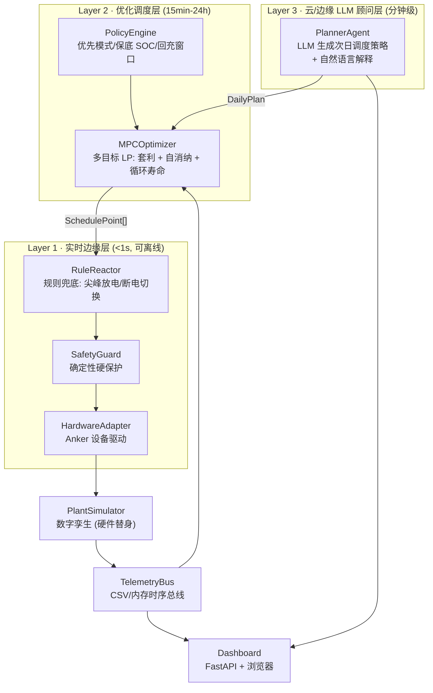

# Anker 智能用电管家 · 架构与接口契约 (FROZEN v1)

> 本文件是**并行开发的唯一接口契约**。任何模块改动公共签名必须先改本文件。
> 目标:Anker 储能硬件 + 边缘算力上的「分时电价套利 + 光伏自消纳」三层调度 Agent。

---

## 1. 总览:三层异构控制架构



**关键设计取舍:LLM 不直接控制硬件。** 安全与实时动作 100% 由确定性代码执行;LLM 只输出"策略意图 + 参数 + 解释",经 LP 求解器与 SafetyGuard 双重校验后才落地。断电/断网时 Layer 1 独立可运行。

---

## 2. 目录与职责

| 路径 | 层 | 职责 |
|---|---|---|
| `src/core/tariff.py` | 域 | 分时电价表、时段解析、日/月账单 |
| `src/core/solar.py` | 域 | 天气→光伏功率预测 |
| `src/core/battery.py` | 域 | 电池模型与退化成本 |
| `src/core/hardware.py` | 域 | 设备规格库与拓扑 |
| `src/core/lp.py` | 域 | 纯 Python 单纯形 LP 求解器 |
| `src/core/policy.py` | 域 | 策略参数与安全护栏阈值 |
| `src/core/optimizer.py` | 优化 | MPO 多目标优化调度 |
| `src/core/explain.py` | 优化 | 策略→自然语言解释模板 |
| `src/edge/safety.py` | 实时 | 硬保护 |
| `src/edge/reactor.py` | 实时 | 规则反应器 |
| `src/edge/plant.py` | 实时 | 数字孪生 |
| `src/edge/telemetry.py` | 实时 | 时序总线 |
| `src/edge/store.py` | 实时 | 状态持久化 |
| `src/agent/llm.py` | LLM | OpenAI 兼容客户端 |
| `src/agent/planner.py` | LLM | 策略生成与解释 |
| `src/agent/fleet.py` | LLM | 多设备/多站点编排 |
| `src/agent/hardware_adapter.py` | 驱动 | Anker 设备适配 |
| `src/serving/app.py` | 服务 | HTTP API |
| `src/serving/api.py` | 服务 | 请求/响应模型 |
| `src/web/` | 前端 | 单页仪表盘 |

依赖方向严格单向:`serving → agent → core`、`serving → edge → core`。`core` 不得 import `edge`/`agent`/`serving`。

- **运行环境**:Python 3.9(系统自带),严禁 `match`、`X | Y` 类型联合(除非 `from __future__ import annotations`)、3.10+ 标准库特性。
- **第三方依赖**:仅 `fastapi` + `uvicorn`(已装)。`numpy` 可用但 **`core` 优化链路必须用纯 Python 实现**(边缘设备无 numpy),`numpy` 只允许出现在测试/分析脚本。

---

## 3. 冻结数据契约

统一用 `@dataclass`(不是 pydantic),`core/__init__.py` 只做 re-export。

### 3.1 `core/tariff.py`

```python
@dataclass(frozen=True)
class TariffTier:
    name: str            # "sharp_peak" | "peak" | "flat" | "valley" | "deep_valley"
    start_hour: float    # 含,0-24,支持 22.5 表示 22:30
    end_hour: float      # 不含;可 >24 表示跨零点(如 22.0 -> 30.0)
    price: float         # 元/kWh

@dataclass(frozen=True)
class TariffPlan:
    city: str
    currency: str                     # "CNY"
    tiers: Tuple[TariffTier, ...]
    export_price: float               # 上网电价 元/kWh
    tier_order: Tuple[str, ...]       # 由便宜到贵,用于策略比较
    def price_at(self, hour: float) -> float: ...
    def tier_at(self, hour: float) -> str: ...
    def daily_curve(self, step_hours: float = 0.25) -> List[Tuple[float, float, str]]: ...
    def spread(self) -> float: ...    # max - min 元/kWh
    def windows(self, tier: str) -> List[Tuple[float, float]]: ...

def builtin_tariffs() -> Dict[str, TariffPlan]: ...   # 至少 6 个城市
def load_tariff(path: str) -> TariffPlan: ...          # JSON
```

### 3.2 `core/battery.py`

```python
@dataclass
class BatteryConfig:
    capacity_kwh: float
    max_charge_kw: float
    max_discharge_kw: float
    round_trip_eff: float = 0.90      # 往返效率
    soc_min: float = 0.05
    soc_max: float = 1.0
    soc_start: float = 0.30
    cycle_life: int = 6000            # 循环寿命
    pack_cost_cny: float = 12000.0    # 整包成本,用于退化成本
    reserve_soc: float = 0.10         # 保底备电 SOC(策略护栏)

@dataclass
class BatteryState:
    soc: float
    soh: float = 1.0
    cycles: float = 0.0
    temp_c: float = 25.0

class BatteryModel:
    def __init__(self, cfg: BatteryConfig) -> None: ...
    def step(self, state: BatteryState, power_kw: float, hours: float,
             temp_c: float | None = None) -> Tuple[BatteryState, float]:
        """power_kw >0 充电,<0 放电。返回 (新状态, 本步退化成本元)。原地不改入参。"""
    def degradation_cost(self, throughput_kwh: float) -> float: ...
    def feasible_power(self, state: BatteryState, power_kw: float) -> float:
        """夹紧到 SOC/功率边界内的可行功率。"""
```

> 约定:`power_kw` 是 **电网侧/交流侧** 功率;充电时电池吸收 `power_kw * sqrt(round_trip_eff)`,放电时放出 `|power_kw| * sqrt(round_trip_eff)`。

### 3.3 `core/solar.py`

```python
@dataclass
class WeatherForecast:
    hours: List[float]                # 0..23
    cloud_cover: List[float]          # 0..1
    temp_c: List[float]
    ghi_wm2: List[float]              # 晴空水平面辐照
    precipitation: List[float] = field(default_factory=list)

@dataclass
class SolarForecast:
    hours: List[float]
    pv_kw: List[float]                # 逐时预测出力
    confidence: List[float]           # 0..1,用于鲁棒优化

class SolarModel:
    def __init__(self, capacity_kwp: float, tilt_derate: float = 0.85) -> None: ...
    def forecast(self, weather: WeatherForecast) -> SolarForecast: ...
    def energy_kwh(self, fc: SolarForecast) -> float: ...

def synthetic_weather(day: str = "clear", seed: int = 7) -> WeatherForecast: ...
    # day in {"clear","cloudy","overcast","rain","heatwave"} —— 确定性可复现
```

### 3.4 `core/hardware.py`

```python
@dataclass(frozen=True)
class DeviceSpec:
    model: str
    capacity_kwh: float
    max_charge_kw: float
    max_discharge_kw: float
    pv_input_kw: float
    ac_output_kw: float          # 连续
    surge_kw: float
    round_trip_eff: float
    grid_tie: bool               # 是否支持并网/峰谷调度
    controllable: bool           # 是否可第三方自动化控制
    comms: Tuple[str, ...]       # ("wifi","ble","matter","modbus","cloud_api")
    price_cny: float

@dataclass
class HomeLoad:
    base_kw: float                       # 基础负荷
    hourly_profile: List[float]          # 24 点归一化系数
    critical_kw: float = 0.4             # 断电容忍最小功率

class HardwareCatalog:
    def __init__(self) -> None: ...
    def get(self, model: str) -> DeviceSpec: ...
    def models(self) -> List[str]: ...
    def battery_config(self, model: str, soc_start: float | None = None) -> BatteryConfig: ...
    # 组合拓扑:多个设备并联 -> 聚合 BatteryConfig
    def aggregate(self, models: List[str]) -> BatteryConfig: ...

def demo_site() -> "SiteConfig": ...
```

### 3.5 `core/lp.py` — 纯 Python 单纯形

```python
@dataclass
class LPProblem:
    c: List[float]                       # min c^T x
    a_ub: List[List[float]]; b_ub: List[float]
    a_eq: List[List[float]] | None; b_eq: List[float] | None
    bounds: List[Tuple[float | None, float | None]]
    n_vars: int

@dataclass
class LPSolution:
    status: str                          # "optimal" | "infeasible" | "unbounded"
    x: List[float]
    objective: float

def solve_lp(p: LPProblem, max_iter: int = 2000) -> LPSolution: ...
```

### 3.6 `core/policy.py`

```python
@dataclass
class PolicyParams:
    mode: str = "arbitrage"        # "arbitrage"|"self_consumption"|"resilience"|"balanced"
    reserve_soc: float = 0.10
    target_soc: float = 0.95
    max_cycles_per_day: float = 1.2
    risk_aversion: float = 0.5     # 0=激进 1=保守,缩放预测置信度
    degradation_weight: float = 0.35   # 退化成本权重 (元/kWh 等效)
    allow_export: bool = True
    comfort_max_peak_kw: float | None = None

@dataclass
class GuardRails:
    min_reserve_soc: float = 0.10
    max_soc: float = 0.98
    max_charge_kw: float | None = None
    max_discharge_kw: float | None = None
    blackout_hold_soc: float = 0.50
    temp_derate_c: float = 45.0

def clamp_params(p: PolicyParams, rails: GuardRails) -> PolicyParams: ...
def validate_params(p: PolicyParams) -> List[str]: ...   # 返回人类可读问题列表
```

### 3.7 `core/optimizer.py` — 核心

```python
@dataclass
class SchedulePoint:
    hour: float
    tier: str
    price: float
    load_kw: float
    pv_kw: float
    battery_kw: float            # >0 充电,<0 放电(交流侧)
    grid_kw: float               # 正=买电,负=卖电
    soc: float
    cost_cny: float              # 该时段净电费(负=收益)
    action: str                  # "charge"|"discharge"|"idle"|"export"|"hold"

@dataclass
class PlanResult:
    site_id: str
    model: str
    params: PolicyParams
    points: List[SchedulePoint]
    baseline_cost_cny: float
    optimized_cost_cny: float
    degradation_cost_cny: float
    savings_cny: float
    savings_pct: float
    export_revenue_cny: float
    pv_self_consumption: float    # 0..1
    cycles_used: float
    solver_status: str
    rationale: List[str] = field(default_factory=list)   # 由 explain.py 填充
    def to_dict(self) -> dict: ...

class MPCOptimizer:
    def __init__(self, battery: BatteryModel, tariff: TariffPlan, params: PolicyParams) -> None: ...
    def optimize(self, load_kw: List[float], pv_kw: List[float],
                 hours: List[float] | None = None,
                 horizon_hours: int | None = None) -> PlanResult: ...
    def baseline(self, load_kw, pv_kw, hours=None) -> float: ...
```

**时序约定**:`hours` 为 [0,1,...,23] 整数小时,一天 24 步。`load_kw[i]` 与 `pv_kw[i]` 是**该小时内平均功率 kW**,故能量 kWh 数值等于 kW。优化目标:

```
min  Σ_t [ price_t · grid_buy_t − export_price · grid_sell_t + w_deg · deg_cost_t ]
s.t. grid_buy_t − grid_sell_t = load_t − pv_t + charge_t − discharge_t
     soc_t = soc_{t−1} + sqrt(rte)·charge_t/C − discharge_t/(sqrt(rte)·C)
     soc_min ≤ soc_t ≤ soc_max ; |charge|≤P_c ; |discharge|≤P_d
     grid_sell_t = 0 当 allow_export=False
     Σ(charge+discharge)/2/C ≤ max_cycles_per_day
```

### 3.8 `core/explain.py`

```python
def explain_plan(res: PlanResult) -> List[str]: ...          # 3-6 条中文要点
def compare_plans(a: PlanResult, b: PlanResult) -> List[str]: ...
```

### 3.9 `edge/*`

```python
# edge/safety.py
@dataclass
class SafetyVerdict:
    allowed: bool
    clamped_kw: float
    reasons: List[str]

class SafetyGuard:
    def __init__(self, battery: BatteryModel, rails: GuardRails) -> None: ...
    def check(self, state: BatteryState, requested_kw: float, temp_c: float = 25.0) -> SafetyVerdict: ...

# edge/reactor.py
@dataclass
class ReactorDecision:
    power_kw: float
    source: str          # "plan"|"rule"|"safety"
    action: str
    reason: str

class RuleReactor:
    def __init__(self, tariff: TariffPlan, guard: SafetyGuard, params: PolicyParams) -> None: ...
    def decide(self, hour: float, soc: float, planned_kw: float, stale: bool = False) -> ReactorDecision: ...

# edge/plant.py
@dataclass
class SiteReading:
    ts: float; hour: float; soc: float; pv_kw: float; load_kw: float
    battery_kw: float; grid_kw: float; price: float; tier: str; temp_c: float
    def to_row(self) -> Dict[str, object]: ...

class PlantSimulator:
    def __init__(self, battery: BatteryModel, load: HomeLoad, solar: SolarModel,
                 weather: WeatherForecast, tariff: TariffPlan, seed: int = 1) -> None: ...
    def step(self, hour: float, requested_kw: float, dt_hours: float = 1.0) -> SiteReading: ...
    def run_day(self, schedule: List[SchedulePoint] | None = None) -> List[SiteReading]: ...
    @property
    def state(self) -> BatteryState: ...

# edge/telemetry.py
class TelemetryBus:
    def __init__(self, keep: int = 5000) -> None: ...
    def push(self, r: SiteReading) -> None: ...
    def recent(self, n: int = 200) -> List[Dict[str, object]]: ...
    def to_csv(self, path: str) -> None: ...

# edge/store.py
class StateStore:
    def __init__(self, path: str) -> None: ...    # JSON 文件持久化
    def save(self, key: str, value: object) -> None: ...
    def load(self, key: str, default: object = None) -> object: ...
```

### 3.10 `agent/*`

```python
# agent/llm.py
@dataclass
class LLMConfig:
    model: str = "qwen3.8-flash"
    base_url: str = "https://dashscope.aliyuncs.com/compatible-mode/v1"
    api_key_env: str = "DASHSCOPE_API_KEY"
    timeout: float = 30.0
    temperature: float = 0.3

class LLMClient:
    def __init__(self, cfg: LLMConfig | None = None) -> None: ...
    @property
    def available(self) -> bool: ...
    def chat(self, messages: List[Dict[str, str]], json_mode: bool = False,
             max_tokens: int = 800) -> str: ...
    def chat_json(self, messages: List[Dict[str, str]], max_tokens: int = 800) -> dict: ...
        # 解析失败返回 {} 且不抛异常

# agent/planner.py
@dataclass
class DailyPlan:
    params: PolicyParams
    rationale: List[str]
    source: str            # "llm" | "rule_fallback"
    raw: str = ""

class PlannerAgent:
    def __init__(self, client: LLMClient, tariff: TariffPlan,
                 rails: GuardRails | None = None) -> None: ...
    def plan(self, weather: WeatherForecast, load_kw: List[float],
             soc: float, history: List[str] | None = None) -> DailyPlan: ...
    def explain(self, res: PlanResult) -> List[str]: ...

# agent/fleet.py
@dataclass
class SitePlan:
    site_id: str
    result: PlanResult

class FleetOrchestrator:
    def __init__(self, optimizer_factory, tariff: TariffPlan) -> None: ...
    def coordinate(self, sites: Dict[str, Dict[str, object]]) -> List[SitePlan]: ...

# agent/hardware_adapter.py
class AnkerDeviceAdapter(ABC):
    def connect(self) -> bool: ...
    def read_state(self) -> BatteryState: ...
    def set_power(self, power_kw: float) -> bool: ...
    def capabilities(self) -> Dict[str, object]: ...

class SimulationAdapter(AnkerDeviceAdapter): ...   # 默认
class SolixCloudAdapter(AnkerDeviceAdapter): ...
    # 真实云 API 未知 -> 默认只读探测,写操作 raise NotImplementedError,
    # capabilities()["control"] = "unsupported"（绝不伪造真实控制能力）
def build_adapter(spec: DeviceSpec, mode: str = "simulation", **kw) -> AnkerDeviceAdapter: ...
```

### 3.11 `serving/*`

| 方法 | 路径 | 说明 |
|---|---|---|
| GET | `/` | 仪表盘 HTML |
| GET | `/api/health` | `{status, llm_available, models, cities}` |
| GET | `/api/hardware` | 设备规格库 |
| GET | `/api/tariffs` | 各城市电价表 + 曲线 |
| GET | `/api/plan` | 查询参:`city, model, mode, weather, risk`;返回 `PlanResult.to_dict()` + `reading` 当前状态 |
| POST | `/api/plan` | body 见下,同上 |
| GET | `/api/stream` | SSE,每秒推送一条 `SiteReading` JSON |
| GET | `/api/simulate` | 查询参:`hours=24,interval=0.25`;返回闭环仿真时序 |

`POST /api/plan` 请求体:

```json
{"city":"shenzhen","model":"SOLIX_F3800","mode":"arbitrage","weather":"clear",
 "risk_aversion":0.5,"reserve_soc":0.1,"use_llm":false,
 "load_kw":null,"pv_kw":null,"capacity_kwh":null}
```

响应额外字段:`soc_now`, `tier_now`, `price_now`, `llm_available`, `params`, `rationale`, `explain`.

---

## 4. 测试与验收

- 每层 `src/tests/test_<module>.py`,`pytest -q`,全部纯标准库 + 已装依赖。
- 硬性验收:
  1. `optimize()` 在 6 城市 × 3 模式 × 3 天象 = 54 组组合下 `solver_status == "optimal"` 且 `savings_pct > 0`。
  2. `SafetyGuard` 在 SOC 边界、温度越限、功率越限下必须夹紧 (`allowed=False` 或 `clamped_kw != requested`)。
  3. `RuleReactor` 在 plan 缺失 (`stale=True`) 时仍返回合法 `source=="rule"` 决策。
  4. `PlanResult.to_dict()` 可 JSON 序列化(`json.dumps` 不报错)。
  5. LLM 不可用时 `PlannerAgent.plan()` 必须回退 `source=="rule_fallback"` 且不抛异常。
  6. 24h 闭环 `PlantSimulator.run_day()` SOC 全程在 `[soc_min, soc_max]` 内,且无 `NaN`。
