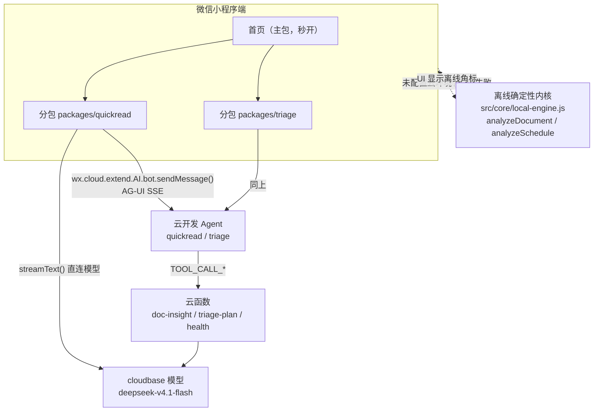

> **观猹 × 2026 微信小程序开发大赛** · 截止 **2026-10-17** · 奖金池 49 万元 · 官方入口 [watcha.cn/activities/activity-74](https://watcha.cn/activities/activity-74)

# 观猹：AI 一页纸快读 + 日程断舍离

一句话定位：**把长文和待办堆在微信里 5 秒看完、10 秒决定**——一个秒开、离线可用、云开发 AI 增强的工具型小程序。

---

## 1. 痛点

1. **长文阅读成本高**：财报、论文、公众号长文动辄上万字，读完才知道值不值得读；现有 AI 摘要工具要复制粘贴到站外，链路断裂。
2. **待办堆积导致决策疲劳**：列表越攒越长，每天花的时间在"纠结先做哪条"上，而不是执行；删除条目时需要一个外部理由来减轻心理负担。
3. **AI 小程序首屏等待过久**：多数参赛作品把模型调用放在首页加载路径上，白屏 2–5 秒，用户直接划走——秒开本身就是留存指标。

## 2. 产品：三个 tab

| Tab | 做什么 | 入口 | 截图占位 |
| --- | --- | --- | --- |
| 首页 | 秒开壳 + 两个入口卡 + 历史记录角标（本地缓存） | `src/pages/home`（主包） | `doc/screenshots/01-home.png`（待人工补拍） |
| AI 一页纸快读 | 粘贴长文/分享链接 → 流式输出投研五区块：一句话结论 / 关键财务指标徽章 / 风险红线警示卡（应收账款异动、大股东减持等自动归类分级）/ 行业竞争格局 / 原文引用 | `src/pages/quickread`（主包 tab）+ 详情/历史在 `packages/quickread`（分包） | `doc/screenshots/02-quickread.png`（待人工补拍） |
| 日程断舍离 | 把今日待办一股脑丢进去 → Top3 必做 / 可延后 / 建议删除（含理由） / 时间块 | `src/pages/triage`（主包 tab）+ 今日安排在 `packages/triage`（分包） | `doc/screenshots/03-triage.png`（待人工补拍） |

关键组件：`markdown-card`（投研排版：指标徽章 / 风险红线卡 / 格局对比）、`stream-lines`（SSE 逐行上屏）、`step-trace`（工具调用轨迹）、`empty-state`（空态与离线提示）。详情页与今日页均带**打字机式流式追问**，预置一键追问（如「分析该标的核心护城河与三大估值下行风险」），由 `local-engine.localAnswer` 确定性作答。

## 3. 架构图



主链路走 `wx.cloud.extend.AI.bot.sendMessage()`（AG-UI SSE，事件含 `RUN_STARTED`/`TEXT_MESSAGE_CONTENT`/`TOOL_CALL_*`/`RUN_FINISHED`），或 `wx.cloud.extend.AI.createModel('cloudbase').streamText()` 直连流式。任何云侧失败（`core/ai-adapter.js` 判定）都自动降级为**离线确定性内核** `src/core/local-engine.js`（TF-IDF 摘要 + 正则提数，真实计算非假数据；输出同构四区块 JSON，`usage.mode:'local'`）。

## 4. 秒开机制

- **首包只含首页**：两个功能 tab 全部在分包 `packages/quickread`、`packages/triage`，主包受微信 2MB 硬限约束，由 `npm run size`（`tools/` 产出）校验。
- **`lazyCodeLoading: "requiredComponents"`**：`src/app.json` 声明，按需注入组件代码；CI 的 `guard` job 断言该字段不被改动。
- **分包按需 + `wx.preloadSubpackage`**：进入首页 `onShow` 后空闲时预载分包，用户点 tab 时多数情况已就绪。
- **t0 同步缓存渲染**：首屏在 `App.onLaunch` 用 `wx.getStorageSync` 同步渲染历史角标与骨架，不等任何异步请求。
- **可验证观测点**：开发者工具「Trace → 小程序启动」看首次渲染帧；`step-trace` 组件展示云链路耗时；`npm run demo` 离线模拟同一渲染顺序。

## 5. 快速开始

1. 微信开发者工具 → 导入项目，目录选**项目根目录**（含 `project.config.json`；`miniprogramRoot` 已指向 `src/`）。详细导入、AppID/测试号、本地设置、离线降级与真机预览见 [docs/WECHAT_DEVTOOLS_GUIDE.md](docs/WECHAT_DEVTOOLS_GUIDE.md)。
2. 替换根目录 `project.config.json` 的 `appid` 为你自己的小程序 AppID（或直接选「使用测试号」）。
3. **（可选，接入云 AI）**按 [agent/README.md](agent/README.md) 在云开发控制台创建 Agent，把环境 ID 填入 `src/config.js` 的 `CLOUD_ENV`、botId 填入 `AGENT_BOT_ID`（当前为单值字符串；分场景双 bot 需按该文件注释扩展为映射）。
4. **（可选，部署云函数）**`tcb fn deploy --config cloudbaserc.json`，或控制台逐个上传 `cloudfunctions/*`。
5. 编译预览。

**不配云环境的离线体验路径**：跳过步骤 3–4 直接编译——卡片标注「离线分析」（`usage.mode:'local'`），快读与断舍离仍由 `local-engine` 给出确定性结果，可完整演示。CI 与 `npm run verify` 全程不依赖云环境。

**评委 H5 直测（免微信开发者工具）**：用任意现代浏览器直接打开 `web-sim/index.html`（双击即可，无需服务器/联网）。内嵌 iPhone 16 Pro 外框 + 微信状态栏，还原 TabBar 切换、页面流转与 Storage 缓存（localStorage 等价 `wx.setStorageSync`）；其分析内核由 `node tools/build-h5-sim.js` 从 `src/core/local-engine.js` **原样打包**——与小程序端同一份确定性代码、同输入同输出，修改内核后重跑该命令即可。

## 6. 一键验证

> `package.json` scripts 已落地：`check` / `test`（`node --test`）/ `verify` / `demo` / `size`（无第三方依赖）。当前状态：`npm run verify` 全绿——13 条静态规则 0 失败 + 41/41 单元测试通过。

| 命令 | 做什么 | 预期输出 | 退出码 |
| --- | --- | --- | --- |
| `npm run verify` | check + test 全链路 | 静态校验通过 + 单测全部 pass | `0` |
| `npm run demo` | `tools/demo.js` 用 `local-engine` 跑一次快读 + 一次断舍离 | 两段 JSON（4 区块），`mode:"local"` | `0` |
| `npm run size` | 主包体积估算（对照 2MB 硬限） | 主包字节数与是否超限 | 超限时非 `0` |
| `node --check cloudfunctions/health/index.js` 等 | 云函数语法自检 | 无输出即通过 | `0` |

CI（[.github/workflows/ci.yml](.github/workflows/ci.yml)）在每次 push / PR 上跑同一件事：语法遍历 → 条件 `npm run check` / `npm test` → `guard` 断言 `src/app.json` 的 `lazyCodeLoading`。

## 7. 目录结构

```text
09_watcha-wechat-miniapp/
├── README.md                     # 本文档（赛事主文档）
├── RULES.md                      # 官方规则与打分指标
├── cloudbaserc.json              # CloudBase CLI 部署配置（3 个云函数）
├── package.json                  # 依赖清单与 scripts（由并行任务产出）
├── .github/workflows/ci.yml      # CI：verify + guard
├── agent/                        # Agent 规格（本任务产出）
│   ├── system-prompt-quickread.md  # 一页纸快读 system prompt（严格 JSON）
│   ├── system-prompt-triage.md     # 日程断舍离 system prompt（严格 JSON）
│   ├── tools.json                  # AG-UI 工具声明（client/server）
│   └── README.md                   # 云开发控制台配置清单（≤15 步）
├── cloudfunctions/               # 云函数（本任务产出，全异常捕获、绝不 throw）
│   ├── health/                   #   连通性探针，无副作用
│   ├── doc-insight/              #   快读结构化抽取（cloudbase/deepseek-v4.1-flash）
│   └── triage-plan/              #   日程决策 top3/later/drop/blocks
├── src/                          # 小程序工程（由并行任务产出）
│   ├── app.json / app.js         #   lazyCodeLoading=requiredComponents
│   ├── config.js                 #   CLOUD_ENV / AGENT_BOT_ID
│   ├── pages/home|quickread|triage/  # 主包：首页 + 两个 tab 场景页（tabBar 页必须在主包）
│   ├── packages/quickread/       #   分包：详情页 detail、历史页 history
│   ├── packages/triage/          #   分包：今日安排页 today
│   ├── components/               #   markdown-card / stream-lines / step-trace / empty-state
│   └── core/                     #   ai-adapter.js / local-engine.js / skeleton.js / stream-bus.js
├── tests/                        # 单元测试（由并行任务产出）
├── tools/                        # check-static.js / demo.js / size.js / build-h5-sim.js
├── web-sim/                      # H5 评委直测模拟器（index.html 浏览器直开，不占小程序包体）
└── doc/                          # 架构文档与 DEPLOY-NOTES.md（由并行任务产出）
```

## 8. 云函数部署

`cloudbaserc.json`（version `2.0`）声明三个函数的 `name`、`timeout: 20`、`runtime: "Nodejs18.15"`、`envVariables: {}`。

方式一（CLI，需联网）：

```bash
npm i -g @cloudbase/cli && tcb login
tcb fn deploy --config cloudbaserc.json
```

方式二：云开发控制台 → 云函数 → 逐个上传 `cloudfunctions/<name>/`（`index.js` + `package.json` + `config.json`，依赖 `wx-server-sdk ~2.6.3`）。

小程序端调用示例：

```js
// 环境连通性冒烟
const res = await wx.cloud.callFunction({ name: 'health' })
console.log(res.result) // { ok: true, ts, sdk: 'wx-server-sdk', version: '1.0.0' }

// 结构化抽取（云侧异常返回 { ok:false, error }，前端据此降级）
const out = await wx.cloud.callFunction({
  name: 'doc-insight',
  data: { text, scene: 'quickread', maxSentences: 3 }
})
```

## 9. 交付物清单

| 交付物 | 状态 | 路径 / 说明 | 兜底 |
| --- | --- | --- | --- |
| 源码仓库 | 进行中 | 本仓库（含 `package.json` 依赖清单、云函数、CI） | — |
| 演示视频（2–5 分钟） | **待人工确认** | 脚本由 `doc/DEMO-SCRIPT.md`（并行任务）给出；录屏需人工 | 离线内核（`usage.mode:'local'`）可全程演示，无需云环境 |
| 架构与说明文档 | 已产出（静态校验通过） | 本文档 + `agent/README.md` + `doc/`（并行任务） | — |
| 在线体验 / 体验二维码 | **待人工确认** | 需真实 AppID + 上传体验版，人工完成 | 离线体验路径 + `npm run demo` |
| CI | 已产出（本机未跑 GitHub Actions） | `.github/workflows/ci.yml`：verify + guard | 本地等价：`npm run verify` |
| 云函数部署 | **待人工确认**（本机无云环境） | `cloudfunctions/` 已过 `node --check` 与 JSON 校验 | 未部署时降级内核不受影响 |

## 10. 诚实声明

本机**没有**微信开发者工具、**没有**云开发环境。因此以下内容只经过**离线验证**：云函数 `node --check` 语法通过、全部 JSON 配置 `JSON.parse` 合法、system prompt 满足「4 区块 + 不可编造 + 严格 JSON」结构断言、CI YAML 结构自检。**未声称**云函数已部署成功、小程序已提审通过、AG-UI 流式已实测连通。

评审前需人工确认的清单：

- [ ] 开发者工具按根目录导入、编译通过，真机预览三 tab 可交互（步骤见 [docs/WECHAT_DEVTOOLS_GUIDE.md](docs/WECHAT_DEVTOOLS_GUIDE.md)）。
- [ ] 按 `agent/README.md` 在云开发控制台创建 Agent 并填入 `CLOUD_ENV` / `AGENT_BOT_ID`（单值字符串），观察一次真实 `RUN_STARTED → … → RUN_FINISHED` 流。
- [ ] `tcb fn deploy` 后调用 `health` 返回 `{ ok:true }`；`doc-insight` 对样例文本返回 4 区块 JSON。
- [ ] 断开云环境验证降级路径：卡片标注「离线分析」（`usage.mode:'local'`）且功能可用。
- [ ] 录制演示视频、生成体验版二维码、提交提审。
- [ ] 确认 GitHub Actions 首次运行绿色（本机无法执行）。