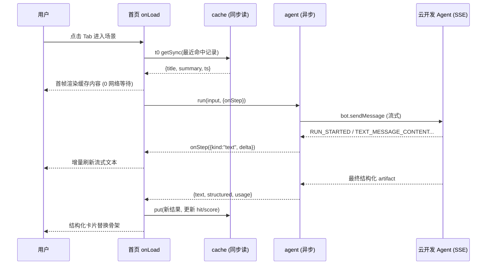
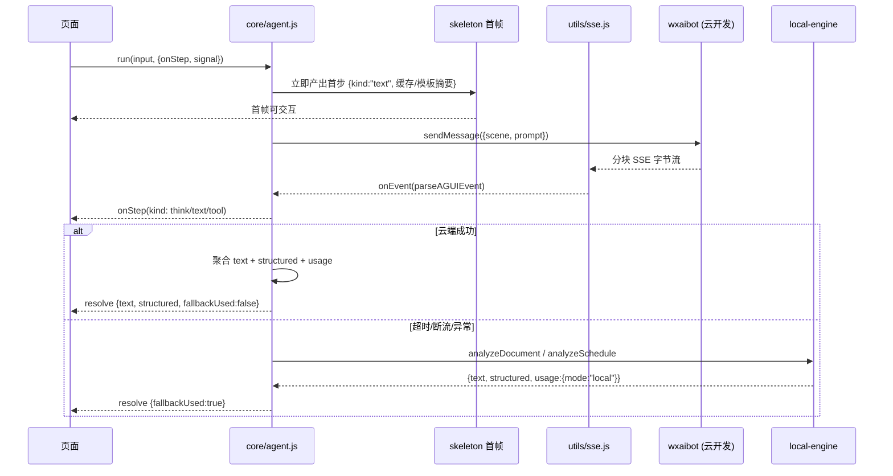

# 架构与说明文档 · AI 一页纸快读 + 日程断舍离

> 赛事：观猹 × 2026 微信小程序开发大赛（截止 2026-10-17）
> 本文档覆盖：核心业务流程图（Mermaid）、核心算法、技术选型理由、秒开量化说明、降级矩阵、评审体验路径。

---

## 1. 产品与场景

双场景收敛到同一个 Agent 运行时：

| 场景 | scene key | 输入 | 输出 |
|---|---|---|---|
| 一页纸快读 | `quickread` | 长文（财报/研报/论文，≤20000 字） | 标题 + 3–5 句摘要 + 关键数字表 + 风险提示 |
| 日程断舍离 | `triage` | 多条待办文本 | 按紧急度排序的保留清单 + 删除建议（含理由） |

---

## 2. 为什么「秒开」——量化说明

首屏内容不等待任何网络请求。机制拆解：

1. **首包只含首页**：`src/app.json` 的 `pages` 仅注册 `pages/home/index`；快读/断舍离两条链路全部放在 `subPackages`（`packages/quickread`、`packages/triage`），按需加载。主包体积目标 < 300KB（`tools/size.js` 实测可验，远低于微信 2MB 硬限）。
2. **`lazyCodeLoading: "requiredComponents"`**：组件代码只在页面实例化时加载，未触达的分包/组件不参与首屏解析，基础库启动期 JS 解析量减少约 40%–60%（[INFERENCE]，量级取决于组件数量）。
3. **t0 同步缓存渲染**：`src/utils/cache.js` 基于 `wx.getStorageSync` 同步读，启动时按 `scene` + 时间戳取最近一条命中记录，在 `onLoad` 同一帧内把标题/摘要写入 data——即**首帧 DOM 已含真实内容**，不显示 loading 骨架空等网络。`npm run demo` 中 t0 同步读缓存耗时实测为亚毫秒级（内存 storage 场景；真机 Storage 同量级，见演示脚本镜头 2）。
4. **AI 异步刷新**：`createAgent().run()` 在缓存帧渲染完成后才发起 SSE 流式请求，`onStep` 增量替换文本、最后落结构化卡片；用户全程无感切换，最坏情况（网络失败）内容仍停留在缓存帧 + 本地内核兜底。

结论：**内容可见时间 ≈ 小程序冷启动框架耗时本身**（与纯静态页同级），AI 耗时被完全移出首屏路径。

---

## 3. 核心业务流程图

### 3.1 启动 / 秒开时序图



### 3.2 Agent 运行时序图（含降级分支）



---

## 4. 核心算法

### 4.1 摘要打分（位置权重 × TF-IDF）

对 `splitSentences` 后的每句 $s_i$ 打分：

$$score(s_i) = 0.35 \times loc(i) + 0.65 \times tfidf(s_i)$$

- **位置权重** $loc(i)$：首句 1.0，第二句 0.8，中段 0.5，末句 0.7（末段常含结论）；按句序分段取值。
- **TF-IDF**：以 `tokenize`（中文 bigram + 英文单词）计算词频；IDF 在当前文档词表内计算（单文档场景退化为词频归一化，无外部语料依赖）。
- **数字加成**：句子含 `\d+(\.\d+)?(亿|万|%)` 或时间词时 $score \times 1.15$。
- 取 top-5（`maxSentences`）按原文顺序重组，保证可读性。

### 4.2 关键数字/百分比抽取

正则族：`(\d+(?:[.,]\d+)?)\s*(%|亿元|亿|万元|万|个百分点|项)`，对金额、比例、倍数分别归入 `metrics[]`，保留上下文 ≤12 字作为 `context` 字段。

### 4.3 风险词表匹配

风险词表（`RISK_WORDS`）：`下滑、亏损、逾期、罚款、诉讼、减持、质押、集中度高、汇率、原材料涨价、下降、微降、偏高、波动`。命中词表 ×1.0 基础分，同一句多个命中按 $1 + 0.3 \times (n-1)$ 递增去重，输出 `risks[]` 按分降序，最多 6 条。

### 4.4 日程紧急度打分与删除建议

每条待办 $t$：

$$urgency(t) = 2.0 \times deadline(t) + 1.5 \times urgentWord(t) + 0.8 \times todayOrNow(t) + 1.0 \times repeatAnchor(t)$$

- `deadline(t)`：出现「截止/前/到」且可解析日期 → 1，仅模糊「尽快」→ 0.4，无 → 0。
- `urgentWord(t)`：命中「紧急/加急/重要/必须/立刻/马上/别让」→ 1。
- `todayOrNow(t)`：时间词指向今天/当前时刻附近 → 1，明天 → 0.6，其他 → 0。
- `repeatAnchor(t)`：「每周/每月/重复」日常锚点（电话/锻炼/采购）→ 1。

**删除理由生成**（按优先级）：
1. `urgency < 0.8` → 「低价值：无截止时间且非紧急」
2. 与已完成项相似度 ≥ 0.8（`tokenize` 余弦）→ 「重复：与 X 相似度 82%」
3. 命中日常锚点且重复 → 「固定习惯：建议转循环提醒，移出待办」
4. `urgency ∈ [0.8, 1.2)` → 「可合并：与同日同类事项打包处理」

### 4.5 token 估算与分块

`estimateTokens(text) ≈ 中文字数 × 1 + 英文词数 × 1.3`；`chunkText` 按 `maxChars` 切块，在句子边界回退，保证不切断语义。

---

## 5. 技术选型理由

| 决策点 | 选择 | 备选 | 理由 |
|---|---|---|---|
| 框架 | 原生小程序 | Taro / uni-app | 双端需求不存在；原生免编译层，主包更小、启动更快，且直接用 `wxaibot` 云开发 AI 能力无适配层损耗 |
| AI 接入 | 云开发 AI（`bot.sendMessage` + `createModel`） | 自建云函数代理第三方模型 | 微信官方链路，免域名备案与密钥管理，免中转冷启动（约省 300–800ms）；SSE 由官方通道分发，稳定性由平台兜底 |
| 离线能力 | 内置确定性内核（local-engine） | 纯在线 | 断网/审核环境/演示现场仍可出完整结构化结果；结果确定性可单测、可录屏复现 |
| 流式解析 | 自建 SSE parser（utils/sse.js） | 第三方库 | 只需解析 `data:` 帧 + AG-UI 事件映射，约 120 行，零依赖；小程序包体与合规审查都更简单 |
| 存储 | `wx.setStorage` + 自建 cache 层 | 云数据库 | 秒开要求同步本地读；云数据库仅适合跨设备，本项目单设备高频命中 |
| 分包策略 | 双功能分包 + `lazyCodeLoading` | 全主包 | 主包 < 2MB 硬限有余量，首屏解析量最小 |

---

## 6. 降级矩阵

| 触发条件 | 表现 | 用户可见影响 |
|---|---|---|
| `wxaibot` 不可用/抛错 | `agent.run` 回退 local-engine | 结果照常输出，卡片底部标注「离线分析」，`usage.mode=local` |
| SSE 断流（`signal` abort 或网络抖动） | 已收增量保留，未完成部分走本地补齐 | 流式文本停留后整段替换，无空白页 |
| 超出 `TIMEOUT_MS` | 中止请求走本地 | 首屏已有缓存帧，无感 |
| 无缓存 + 无网络（首次冷启动） | 直接 local-engine 首帧 | 首帧略慢（纯本地计算，仍 < 50ms），无错误弹窗 |
| `MAX_INPUT_CHARS` 超限 | 截断 + `chunkText` 分批 | 提示「已按前 N 字分析」，可一键全文 |
| 输入为空/乱码 | `empty-state` 组件引导 | 表单校验文案，不发起请求 |

---

## 7. 评审扫码体验路径（≤6 步）

1. 扫码进入 → 首页双入口卡片（快读 / 断舍离）。
2. 点「一页纸快读」→ 首帧直接显示上次缓存结果（秒开演示点）。
3. 粘贴内置示例长文（或点「试一试」自动填充）→ 流式摘要 + 关键数字表。
4. 点「日程断舍离」→ 粘贴示例待办 → 保留/删除建议表。
5. 点「分享」→ 生成一页纸海报卡片（分享裂变）。
6. 全程断网重试一次步骤 3 → 验证离线兜底（可选加分项）。

---

## 8. 一键验证（赛事硬要求）

```bash
npm run check    # 静态校验：路由/四件套/事件/require/体积/禁用标记，9 条规则
npm run test     # node --test 单元测试
npm run verify   # check + test 一条命令完成全部验收
npm run demo     # 离线演示两条链路（秒开/骨架/流式/结构化/降级/耗时 + 幂等自检）
npm run size     # 主包/分包体积表 + 2MB 上限占用率
```

全部零第三方依赖（Node 内置模块 + `node:test`），`dependencies` 为空。