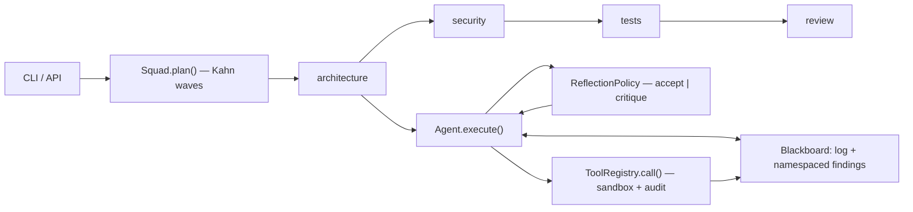

# agent-squad — Multi-Agent Collaboration with Self-Reflection & Closed-Loop Tools

**Open Agent Hackathon 2026 (GenAI Works)** · category: autonomous agents / multi-agent collaboration.

A small, **dependency-free** (Python standard library only) framework that makes
three things structural instead of aspirational:

1. **Multi-agent collaboration** — specialised agents coordinate through a shared
   blackboard and a dependency DAG of waves.
2. **Autonomous self-reflection** — every agent must pass a deterministic rubric
   before its output leaves the agent; failures come back as a concrete critique
   and the draft is rewritten.
3. **Closed-loop tool execution** — the only way an agent can claim something
   about the world is by calling a sandboxed tool whose result is replayed into
   the next model turn. Every call is validated, capped, and audited.

The reference workload is the *code-quality audit squad* from the hackathon
brief: Architecture Reviewer → Security Sniffer → Test Engineer → Lead Auditor.

## Quickstart (no credentials, no network)

```bash
python -m squad.cli demo          # audits a generated flawed sample package
python -m squad.cli audit ./path  # audits YOUR package (py/md by default)
python -m squad.cli demo --json   # machine-readable payload
```

From a clone, without installing anything:

```bash
PYTHONPATH=src python3 -m squad.cli demo
```

With Docker (one command, nothing else needed):

```bash
docker build -t agent-squad . && docker run --rm agent-squad
```

Tests (stdlib `unittest`, no third-party dependency required):

```bash
PYTHONPATH=src python3 -m unittest discover -s tests -t .
# or, if installed:  pip install -e '.[dev]' && pytest
```

## Using a real model

The framework speaks the OpenAI-compatible `/chat/completions` protocol over
`urllib` — OpenAI, DashScope-compatible gateways, vLLM, Ollama's OpenAI shim:

```bash
export OMP_BASE_URL=https://api.openai.com/v1
export OMP_API_KEY=sk-...
export OMP_MODEL=gpt-4o-mini
python -m squad.cli audit ./src --live
```

| Variable | Default | Meaning |
|---|---|---|
| `OMP_BASE_URL` | `https://api.openai.com/v1` | endpoint root |
| `OMP_API_KEY` (or `OPENAI_API_KEY`) | — | bearer token |
| `OMP_MODEL` | `gpt-4o-mini` | model name |
| `OMP_LLM_MODE` | `auto` | `auto` \| `mock` \| `live` |
| `SQUAD_WORKSPACE` | `.agent-squad/workspace` | tool sandbox root |
| `SQUAD_AGENT_PREFIX` | — | namespace prefix so two squads coexist |

`auto` prefers the real provider and **falls back to the deterministic mock**
when no credentials are present; a failing primary degrades mid-run through
`ProviderFallback` and records a warning instead of crashing the demo.

## Library use

```python
from squad.agent import Agent, ReflectionPolicy
from squad.squad import Squad
from squad.tools import build_default_registry

tools = build_default_registry(workdir="./workspace")

architect = Agent("architect", role="Architecture Reviewer", goal="map module boundaries",
                  tools=tools, policy=ReflectionPolicy(min_score=0.75, max_rounds=3))
sniffer = Agent("sniffer", role="Security Sniffer", goal="find injection sinks", tools=tools)

squad = Squad("audit", max_workers=4)
squad.add(architect, group="architecture")
squad.add(sniffer, group="security", depends_on=("architecture",), needs=(architect.write_namespace,))

result = squad.run(focus="audit ./workspace")
print(result.scores)          # {'architect': 0.87, 'sniffer': 0.81}
print(result["sniffer"].revisions, result["sniffer"].tool_results)
```

## How it works



* **Waves, not a queue.** Agents are grouped; a group declares `depends_on` other
  groups, giving a DAG that `plan()` topologically sorts (Kahn, sorted
  tie-breaking ⇒ stable). Each wave runs in a thread pool behind a barrier, so no
  agent can read a same-wave sibling's in-flight state — that is what makes runs
  reproducible. Cross-agent data flow is explicit via `needs=(namespace,)`.
* **Reflection rubric.** Five deterministic dimensions — `structure` 0.25,
  `coverage` 0.20, `evidence` 0.25, `specificity` 0.15, `actionability` 0.15 —
  acceptance needs `score ≥ 0.75` and every dimension `≥ 0.5`. A rejection emits
  a one-line critique naming the failing dimensions and one concrete instruction,
  which is injected into the next round. Stagnation is detected and flagged.
* **Closed loop.** `ToolRegistry.call()` never raises: unknown tool →
  `NOT_FOUND`, missing/extra args → `MISSING_ARGS`/`EXTRA_ARGS`, hallucinated
  types → `BAD_TYPE`, gated tools → `DANGEROUS`, escapes →
  `PERMISSION`, hangs → `TIMEOUT`. Built-ins are confined by workdir
  containment (`realpath` + `commonpath`), a command allowlist with shell
  metacharacter rejection, subprocess timeouts, and output caps. Every call lands
  in a thread-safe audit log and every result is fed back as an observation.

Full design, algorithm rationale and limitations: [`docs/ARCHITECTURE.md`](docs/ARCHITECTURE.md).
Frozen interfaces: [`docs/CONTRACT.md`](docs/CONTRACT.md).

## Repository layout

```text
src/squad/
  memory.py     # Message + Blackboard (append-only log + namespaced findings, RLock)
  tools.py      # ToolSpec/ToolResult/ToolRegistry + sandboxed built-ins
  llm.py        # OpenAICompatibleLLM, MockLLM, ProviderFallback, build_llm
  agent.py      # Agent.execute(): reflection loop, ReflectionPolicy, AgentResult
  squad.py      # Squad.plan()/run(), SquadResult, event stream
  workflow.py   # workspace inventory, task block, report rendering
  cli.py        # demo | audit | version
src/squads/
  code_audit.py # the reference 4-role audit squad + flawed sample package
tests/          # 65 unittest cases: blackboard concurrency, tool sandbox, rubric,
                # provider fallback, orchestration isolation, end-to-end CLI
docs/           # ARCHITECTURE.md, CONTRACT.md
examples/demo.py
Dockerfile      # runs the offline demo, zero dependencies to install
```

## Deliverable checklist (RULES.md §3)

- [x] Source repository, clean layout, `Dockerfile` + `requirements.txt` + `pyproject.toml`
- [x] One-click runnable demo (`docker run agent-squad`, or `python -m squad.cli demo`)
- [x] Architecture document with the business flow, core algorithms and technology
      rationale (`docs/ARCHITECTURE.md`)
- [ ] Demo video (2–5 min) — script in [`docs/DEMO_SCRIPT.md`](docs/DEMO_SCRIPT.md)
- [ ] Online experience link — run locally or via the Docker image

## Verification

Every claim above is exercised by the suite (`tests/`): real subprocess execution
for `python_exec`, real filesystem writes for `write_file`, real thread contention
on the blackboard, real CLI invocations as subprocesses for the end-to-end path.
Reproducibility is asserted by comparing score maps across repeated runs.
