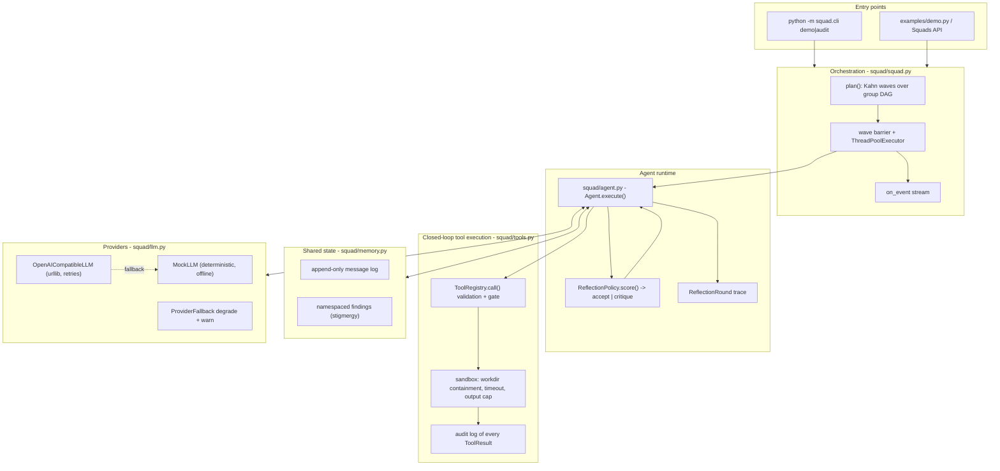

# Architecture — agent-squad (Open Agent Hackathon 2026)

> Status: implementation complete, verification evidence in `README.md`.
> Interface authority: [`CONTRACT.md`](CONTRACT.md).

## 1. Problem / 痛点

Hackathon-grade "agent demos" are almost always a single prompt loop: one
model, one instruction, one answer, no verification. They cannot show the three
things the Open Agent Hackathon judges look for — **multi-agent collaboration**,
**autonomous self-reflection**, and **closed-loop tool execution** — because
nothing in the design forces an agent to check its own work or to touch the real
world.

`agent-squad` is a small, dependency-free framework built so that those three
mechanisms are structural rather than aspirational:

* work is split across specialised agents that coordinate through a shared
  blackboard, never through a single monolithic prompt;
* every agent must pass a deterministic rubric before its output leaves the
  agent — failures are fed back as a critique and the draft is rewritten;
* the only way an agent can make claims about the world is by calling a tool
  whose result is replayed into the next model turn.

## 2. Where the design lives (diagram)



(The same information as text: `Squad.plan()` → waves → each `Agent.execute()`
alternates `LLM.complete` ↔ `ToolRegistry.call` inside a reflection loop, with
the `Blackboard` as the only inter-agent channel and `LLM` as a swappable
provider.)

## 3. Core algorithm 1 — dependency-DAG wave scheduling

Agents are registered into named **groups**. A group may declare `depends_on`
other groups, which forms a DAG. `Squad.plan()` runs **Kahn's algorithm** with
`sorted()` tie-breaking so the wave list is byte-stable:

```text
architecture  ->  security  ->  tests  ->  review
```

Each wave runs inside one `ThreadPoolExecutor(max_workers=min(N, wave_size))`
and is separated from the next by a **wave barrier**: no agent may depend on a
same-wave sibling. This is what makes a run reproducible — an agent that reads a
sibling's in-flight state would produce order-dependent output. Cross-agent data
flow is therefore always explicit: a downstream agent declares
`needs=("upstream-namespace",)` and receives that namespace's findings in its
prompt context. Per-agent `Exception`s are converted into failed
`AgentResult`s inside the worker, so one broken agent cannot abort the squad;
`KeyboardInterrupt`/`SystemExit` are never swallowed.

**Why this over a queue/event-bus design:** waves are trivially debuggable
(the plan is printable before execution), deterministic, and testable — the
whole scheduler is a pure function of the registered graph.

## 4. Core algorithm 2 — the self-reflection loop

Every `Agent.execute()` runs at most `policy.max_rounds` draft rounds. One round is:

1. **Draft.** Build the prompt (`## Task`, `## Context`, `## Available tools`,
   and — from round 1 — a `## Critique` block) and call the provider **once**.
   A response may carry tool calls.
2. **Act.** Execute each tool call through the registry inside the sandbox and
   replay the assistant message plus one `role="tool"` observation message per
   result, then ask the provider again. Continuations are bounded by
   `max_tool_calls`; exhausting the budget is recorded as a warning, never
   silently dropped.
3. **Judge.** `ReflectionPolicy.score()` produces five deterministic
   dimensions, then `evaluate()` decides accept/reject:

| Dimension | Weight | Measurement |
|---|---|---|
| `structure` | 0.25 | fraction of the six required section headers present |
| `coverage` | 0.20 | fraction of task keywords (≥4 chars, deduped, first 12) present |
| `evidence` | 0.25 | distinct file paths cited + tool use + `[tool ` observation markers |
| `specificity` | 0.15 | penalises vague wording, rewards backticked identifiers |
| `actionability` | 0.15 | imperative `- verb` bullets + fix-oriented verbs |

Acceptance needs `score ≥ 0.75`, every dimension `≥ 0.5`, and non-empty output.

4. **Reflect.** A rejection produces a one-line critique naming the failing
   dimensions in ascending score order plus a concrete instruction derived from
   the worst dimension (for example
   `Round 0 rejected: score 0.6000 < 0.75; failing dimensions: coverage (0.00), ...; cover the task keywords you skipped`).
   The critique is appended to the next round's prompt, so the model is told
   exactly what was missing. Stagnation (`score ≤ previous score`) is flagged in
   the critique and in `AgentResult.warnings`.

Scoring is **deterministic** — no clock, no randomness, no second model call —
so the loop is unit-testable and two runs on the same inputs are identical. A
full trace is preserved in `AgentResult.reflections` (per round: output, scores,
critique, tool names, token/latency usage, acceptance).

**Why a rubric instead of "ask the model if it is done":** a model-verdict
reflection loop is unverifiable and non-reproducible; a rubric can be tested,
tuned, and shown in a demo. The provider interface leaves room for an
LLM-judge variant later.

## 5. Core algorithm 3 — closed-loop tool execution

`ToolRegistry.call()` is the trust boundary and **never raises for tool faults**.
Validation order (each failure returns a coded `ToolResult`):

`NOT_FOUND` → `MISSING_ARGS` → `EXTRA_ARGS` (hallucinated parameters are
rejected, not ignored) → `DANGEROUS` gate → `BAD_TYPE` coercion → execution →
`TIMEOUT` / `EXIT` / `PERMISSION` / `ERROR`.

Every tool result feeds back into the next model turn as an observation;
every call is appended to a thread-safe audit log with elapsed time. The
built-ins (`read_file`, `write_file`, `list_files`, `search_text`,
`python_exec`, `shell_command`, `http_get`) are all confined by an explicit
sandbox policy:

* **workdir containment** — `realpath` + `commonpath` check; escape attempts are
  refused (`PERMISSION`), including absolute paths outside the workspace;
* **command allowlist** — `shlex.split` program match plus rejection of shell
  metacharacters (`;`, `|`, `&&`, backticks, `$(`) so no chaining can smuggle a
  second command;
* **resource caps** — subprocess timeout, output byte/char caps with an explicit
  `... [truncated N]` marker, `max_matches`/`max_entries` limits.

The `.agent-squad/` demo workspace is disposable; `squad audit <path>` is the
only path that points tools at real user code, and it is read-mostly (writes are
confined to the audited directory and are reported).

## 6. Shared state — blackboard / stigmergy

`Blackboard` is an append-only message log plus a namespaced findings store,
both `RLock`-guarded (wave agents run concurrently). Agents coordinate by
*stigmergy*: an agent publishes a summary message and patches its own namespace;
downstream agents read it via `needs` rather than by calling upstream code.
`Message.metadata["kind"]` classifies traffic (`assignment`, `summary`,
`revision`, `observation`, `report`, …) and `metadata["thread"]` groups every
message of one task, giving a replayable transcript of the whole collaboration.

**Why not direct agent-to-agent calls:** a shared, inspectable log is what makes
the collaboration demonstrable — the CLI can dump the entire coordination
history, and tests can assert on it.

## 7. Provider layer and the offline-first rule

`llm.py` defines one protocol and two implementations:

* `OpenAICompatibleLLM` — real HTTP via `urllib.request` against
  `{base_url}/chat/completions` (works with OpenAI, DashScope-compatible
  gateways, vLLM, Ollama's OpenAI shim, …). Config from
  `OMP_BASE_URL` / `OMP_API_KEY` / `OMP_MODEL`; retries on 429/5xx with
  exponential backoff; keys never appear in errors.
* `MockLLM` — deterministic, credential-free responder implementing the same
  intent contract (tool request → report → revision). This is the default when
  no credentials exist, which keeps CI and the one-click demo reproducible.
* `ProviderFallback` — degrades a failing primary to the mock and records a
  warning on the agent, so a live demo survives a quota/network failure instead
  of crashing.

`build_llm()` decides with `OMP_LLM_MODE` ∈ {`auto`, `mock`, `live`}; `auto`
prefers the real provider and falls back to the mock.

**Why an offline-first default:** hackathon judging is a cold environment. A
demo that needs a key and network to show *any* value is a demo that may show
nothing. With this design the same code path is exercised with or without
credentials, and the mock is a first-class deterministic target rather than a
test double.

## 8. Reference workload — the code-quality audit squad

`squads/code_audit.py` implements the RULES.md-suggested team:

| Group | Agent | Role | Tools |
|---|---|---|---|
| `architecture` | Architect | module boundaries, coupling, dead code, docs gaps | read/list/search |
| `security` | SecuritySniffer | injection sinks, secrets, unsafe deserialisation | read/search |
| `tests` | TestEngineer | writes regression tests, **runs** them | + write_file, python_exec |
| `review` | LeadAuditor | merges the three artefacts into a release gate | read (+ upstream findings) |

`DEFAULT_SAMPLE_FILES` ships a small intentionally-flawed package (SQL
interpolation, `eval` on payloads, `==` on secrets, mutable default argument,
bare `except`) so `python -m squad.cli demo` produces a real, inspectable audit
without credentials.

## 9. Known limitations / next steps

* Reflection scoring is heuristic text analysis: it rewards structure and
  evidence, but it cannot judge semantic truth — a factually wrong report with
  good structure still passes. An LLM-judge policy is the natural extension.
* Wave isolation means same-wave agents cannot share partial results by design;
  deeply coupled tasks must be modelled as more groups (more barriers).
* Tool sandboxing is policy-based, not OS-level (no container/namespace
  isolation) — `squad audit` should be run on code you are willing to execute
  dependencies of.
* `shell_command` allowlist is conservative by construction; extend per
  deployment rather than widening it globally.
