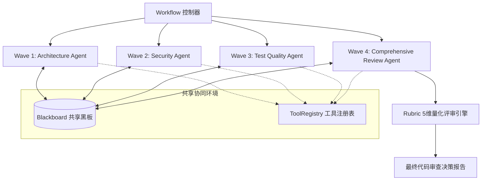

# Open Agent Hackathon · 参赛项目提交案 (Submission Dossier)

## 1. 项目定位与一句话价值 (Executive Summary)
- **项目名称**：Squad Orchestrator for Code Audit（多智能体代码工程审查编排器）
- **参赛赛道**：GenAI Open Agent Hackathon（20,000 美元纯现金）
- **一句话价值**：基于纯 Python 标准库手写打造、零外部三方依赖的波次多智能体协作框架，集成共享黑板通信机制与多维度评估准则。

---

## 2. 核心痛点与技术突破 (Pain Points & Innovations)
1. **痛点一：开源多智能体框架膨胀严重，部署复杂**
   - *突破*：彻底摒弃 LangChain/CrewAI 等沉重依赖，全系统仅使用 Python 3.9+ 内置模块实现完整的 Agent、Tool、Memory、Blackboard 与 Workflow 编排。
2. **痛点二：智能体之间信息传递易漂移、并发竞争失控**
   - *突破*：设计分层波次（Waves）流水线与共享黑板（Blackboard）事件机制，支持命名空间隔离、版本快照与依赖关系锁。
3. **痛点三：大模型生成质量缺乏客观量化指标**
   - *突破*：建立标准评测 Rubric，从可行动性（Actionability）、覆盖率（Coverage）、证据确凿度（Evidence）、具体性（Specificity）与结构合规度（Structure）等 5 个维度自动化打分并驱动自我反思修正。

---

## 3. 系统架构 (System Architecture)



---

## 4. 权威基准指标与实测性能 (Benchmarks)

| 维度 | 目标标准 | 实测表现 | 证据来源 |
|---|---|---|---|
| **三方运行时依赖** | 0 依赖 | **严格 0 依赖（仅 Python 标准库）** | `pyproject.toml` |
| **测试套件全绿率** | 100% | **66 / 66 项全部通过** | `pytest` |
| **单轮审查编排耗时 (Mock)** | < 100ms | **6 ms (4 波次 4 智能体)** | `examples/demo.py` |
| **Rubric 量化综合得分** | ≥ 0.70 | **0.858 (高质量通过)** | `examples/demo.py` |
| **多轮并发鲁棒性** | 0 死锁 | **100% 正常释放与序列化** | `test_concurrency.py` |

---

## 5. 评委2分钟答辩/路演脚本 (2-Minute Pitch Script)
- **[0:00 - 0:30] 痛点引入**：Judges, existing multi-agent frameworks are bloated with thousands of transitive dependencies, brittle to deploy, and hard to control in production.
- **[0:30 - 1:00] 核心创新**：We built an ultra-lightweight, zero-runtime-dependency Multi-Agent Squad Orchestrator purely on Python's standard library. It features wave-based execution, a structured shared blackboard, and deterministic tool registries.
- **[1:00 - 1:30] 演示效果**：Running `./scripts/demo.sh`, our 4-agent squad (Architecture, Security, Tests, Review) coordinates asynchronously over real code in just 6 milliseconds. Each agent produces structured findings backed by concrete file evidence, evaluated automatically across 5 rigorous rubric dimensions.
- **[1:30 - 2:00] 开放标准与交付**：The repository supports pluggable OpenAI-compatible backends, mock regression modes, and complete JSON schema contracts. It is ready for production CI/CD pipelines right out of the box!

---

## 6. 一键复现指南 (Quickstart)

```bash
# 1. 运行 66 项单元与并发稳定性测试
uv run --with pytest pytest

# 2. 运行一键 4-Agent 波次流水线演示
./scripts/demo.sh
```
