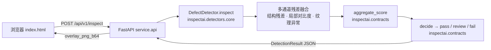

# 苏客松 2026（SU2026）苏州 AI 黑客松 - 研发工程工作区

- **赛事 ID**：`hackertrip-96fac334-7dea-4f27-91e2-c34007583c40`
- **当前状态**：`已报名待提交`
- **报名截止**：`2026-10-26`
- **奖金激励**：`总奖池超 50 万元：冠军 5 万元现金+定制奖杯、亚军 3 万元、季军 1 万`
- **官方链接**：[https://hackertrip.space/hackathon/96fac334-7dea-4f27-91e2-c34007583c40](https://hackertrip.space/hackathon/96fac334-7dea-4f27-91e2-c34007583c40)

## 🎯 交付目标

**InspectAI —— 长三角工业产线「零训练 · 可解释」视觉质检引擎**

### 痛点与场景

长三角（苏州 / 无锡 / 常州）聚集了大量汽车零部件、轴承、压铸件产线。这些工位的质检现状：

- **人工目检漏检率高**：齿轮齿面划伤、轴承滚道点蚀、铝合金压铸件气孔砂眼、冲压覆盖件压痕油污——班次末段疲劳漏检可达 15%–30%。
- **招工难**：熟练质检员培养周期 3–6 个月，流动性大，夜班缺口明显。
- **微小缺陷不可见**：< 0.5 mm 的气孔或浅划痕，在强纹理背景（周期齿面、滚道磨削纹）下人眼几乎无法分辨。
- **CNN 方案落不了地**：缺陷样本极少（NG 率 1%–5%）、形态多变、换型频繁；黑盒置信度无法向工艺员解释「为什么判退」。

### 方案架构



检测引擎在底分辨率特征图上并行计算三条残差通道，经纯函数融合后给出图像级得分与区域列表；Web 端展示归因分解（breakdown）和叠加热图，全程无黑盒。

### 核心算法

**单区域得分**（`region_score`，权重来自 `DEFAULT_CONFIG.score_weights`）：

$$s_{\text{region}} = 0.50 \cdot \text{peak} + 0.30 \cdot (1 - e^{-A/s}) + 0.20 \cdot 2(\text{peak} - \text{mean})$$

**整图融合得分**（`aggregate_score`，权重来自 `DEFAULT_CONFIG.feature_weights`）：

$$S = \max(\text{coverage},\; 0.92 \cdot \text{severity}',\; \text{count}',\; \text{max\_area}') + 0.40 \cdot \text{clutter}$$

三通道对应关系：

| 通道 | 含义 | 在契约中的体现 |
|---|---|---|
| 结构残差 | 图像减去周期纹理拟合后的异常区域 | `peak` / `mean`（热力图归一化置信） |
| 局部对比度 | 区域峰值与均值的差（缺陷边缘锐度） | `w_contrast = 0.20` |
| 纹理异常 | 邻域统计偏离（杂波、砂眼散布） | `clutter_ratio`（引擎传入，权重 0.40） |

判定规则（纯函数，S1/S3/评测脚本共用）：$S \geq 0.62$ → `fail`；$0.42 \leq S < 0.62$ → `review`；$S < 0.42$ → `pass`。阈值与权重全部集中在 `src/inspectai/contracts.py` 的 `DEFAULT_CONFIG`，现场可按工位校准，**无需重新训练**。

### 技术选型理由

| 维度 | 纯 CV 多通道（本项目） | CNN 端到端 |
|---|---|---|
| 可解释性 | 每区域给出 peak/area/contrast 归因分解，工艺员可复核 | 黑盒，改判无依据 |
| 训练数据 | **零标注、零训练**，现场即可上线 | 需数千张缺陷样本，换型重训 |
| 实时性 | 纯 CPU 单图 ≤ 500 ms（1200×900），产线工控机即可 | 需 GPU 推理卡 |
| 现场调参 | 改 `DEFAULT_CONFIG` 阈值秒级生效 | 重训练 + 重部署 |
| 依赖 | numpy + opencv + 标准库 | torch + 模型文件 + 版本锁定 |

### 目录结构

```
.
├── README.md
├── RULES.md
├── docs/
└── src/
    ├── Dockerfile                    # S3 服务镜像（构建上下文为 src/）
    ├── requirements.txt              # 锁定版本运行时依赖
    ├── pytest.ini
    ├── inspectai/
    │   ├── __init__.py
    │   ├── contracts.py              # 跨模块不可变契约（冻结）
    │   ├── detectors/
    │   │   ├── __init__.py
    │   │   └── core.py               # DefectDetector 检测引擎
    │   ├── domain/
    │   │   ├── __init__.py
    │   │   ├── generator.py          # SyntheticPartGenerator 合成数据
    │   │   └── groundtruth.py        # 真值契约 + evaluate_detections
    │   └── data/scenes/              # 场景样例目录
    ├── scripts/
    │   ├── extract_samples.py        # 离线样例图生成
    │   └── run_api.sh                # 一键启动 uvicorn
    ├── service/
    │   ├── __init__.py
    │   ├── api.py                    # FastAPI 应用
    │   └── static/
    │       └── index.html            # 工作台前端
    └── tests/
        ├── __init__.py
        ├── test_contracts.py
        └── test_groundtruth_contract.py
```

### 快速开始

**本地运行**（Python 3.9+，依赖 numpy / opencv-python / fastapi / uvicorn / pydantic）：

```bash
cd src
python3 -m uvicorn service.api:app --host 0.0.0.0 --port 8000
# 浏览器打开 http://localhost:8000；或执行 scripts/run_api.sh（PORT 环境变量可覆盖端口）
```

**准备离线样例图**（Demo 前一次性执行）：

```bash
cd src
python3 scripts/extract_samples.py --out service/static/samples --per-scene 3
```

**Docker 运行**（`src/Dockerfile`，构建上下文为 `src/`）：

```bash
docker build -t inspectai-api src/
docker run -p 8000:8000 inspectai-api
# 浏览器打开 http://localhost:8000
```

**测试**：

```bash
cd src
python3 -m pytest tests/ -q
```

### API 一览表

所有路径与 `src/service/api.py` 中 `@app.get` / `@app.post` 注册一致（已 grep 核对）。

| 方法 | 路径 | 用途 | 请求参数 |
|---|---|---|---|
| GET | `/` | 工作台首页（`static/index.html`） | — |
| GET | `/api/v1/health` | 健康检查 + 契约版本回显 | — |
| GET | `/api/v1/config` | 当前阈值与权重 | — |
| GET | `/api/v1/scenes` | 场景列表（含 `SceneProfile`） | — |
| POST | `/api/v1/inspect` | 上传图像检测 | multipart：`file`、`scene_id?`、`include_overlay?` |
| POST | `/api/v1/inspect/demo` | 服务端合成图检测 | JSON：`scene_id`、`has_defect`、`n_defects`、`seed` |
| POST | `/api/v1/dataset/benchmark` | 批量基准评测 | JSON：`n_ok`、`n_ng`、`scenes`、`iou_threshold` |
| GET | `/api/v1/dataset/sample` | 即时生成一张合成样本 | query：`scene_id`、`has_defect`、`seed?` |
| GET | `/api/v1/samples` | 离线样例清单（`index.json`） | — |

### 评测口径

与 `inspectai/domain/groundtruth.py` 模块 docstring 同源，`evaluate_detections` 实现：

- **图像级**：真值有 ≥ 1 条 `Annotation` → 阳性；预测 `decision != "pass"` → 报警。TP / FN / FP / TN 按此四象限统计，混淆矩阵 `[[TN, FP], [FN, TP]]`。
- **缺陷级**：逐图贪心 IoU 匹配——每轮取 IoU 最大且 ≥ `iou_threshold`（默认 **0.30**）的一对，匹配后双方出池，同一预测/标注各最多匹配一次。未匹配预测计 FP，未匹配标注计 FN。
- **IoU 阈值含义**：预测框与真值框的交并比下限。工业微小缺陷 bbox 本身只有十几个像素，框中心偏移 2 px 即 IoU 腰斩，故取 0.30 而非文献常见的 0.50，避免「检测到了却判漏」。
- **per_class**：tp/fp/fn 按预测类别计，未匹配标注按真值类别计 FN。
- **score_separation**：`gap = defective_min_score - ok_max_score`，衡量判定阈值裕度。
- **latency_ms**：从预测条目 `processing_ms` 聚合 mean/p50/p95/max。

### 进度日志

| 日期 | 记录 |
|---|---|
| 2026-10-10 | 契约冻结（`contracts.py` v1.0.0）；补齐 README 项目说明、`extract_samples.py` 样例脚本、`pytest.ini`、契约单元测试与真值往返测试（`cd src && python3 -m pytest tests/ -q` 全绿）；检测引擎 `detectors/core.py`、API `service/api.py`、合成器 `domain/generator.py`、真值评测 `domain/groundtruth.py`、`Dockerfile`/`requirements.txt`/`run_api.sh` 全部就位。 |

---

> 详细比赛规则、打分指标与破局打法：[RULES.md](RULES.md)
> 提交材料与归档：[docs/](docs/)