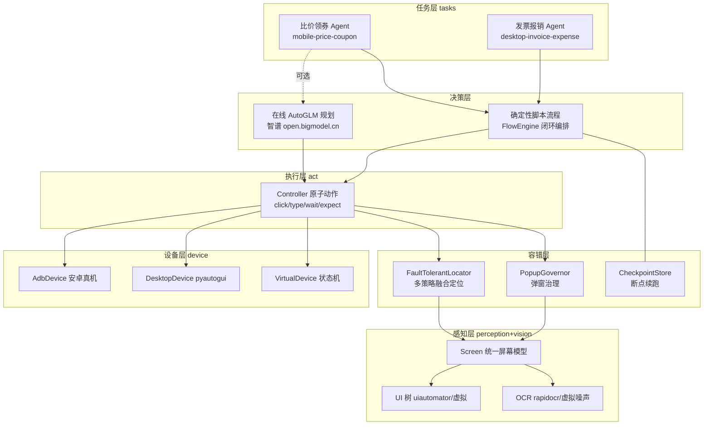

# AutoGLM 端侧智能体 · 架构与技术方案

> 智谱 AI · 2026 AutoGLM 手机与桌面端侧智能体共创挑战赛 参赛工程

## 1. 一句话定位

基于 AutoGLM 决策闭环思想，构建「**多通道容错定位 + 弹窗治理 + 可续跑业务流引擎**」的端侧 GUI 自动化框架，交付两条真实高频痛点闭环：**手机端跨平台比价领券**与**桌面端发票归集报销填单**。

## 2. 总体架构



## 3. 高容错元素定位（核心算法）

单一 `text` 选择器在真实 App 上极其脆弱：文案 A/B、分辨率适配、弹窗遮挡、OCR 误识。定位引擎按**成本从低到高**跑多通道策略并做置信度融合：

| 通道 | 来源 | 置信度 | 作用 |
|---|---|---|---|
| `ui:rid` | resource-id 精确 | 0.97 | 版本稳定的锚点 |
| `ui:text` | UI 树文本精确/包含 | 0.85–0.98 | 主通道 |
| `ui:desc` | content-desc | 0.82 | 图标按钮兜底 |
| `ocr` | OCR 精确/包含/编辑距离模糊 | 0.52–0.94 | 无 UI 树页面（游戏/视频/桌面） |
| `prior` | 归一化坐标先验 | 0.52 | 所有通道失效时的最后救济 |

关键机制：

1. **文本归一化**：NFKC + 全半角折叠 + 去空白 + 小写，吸收「立 即领 取」「立即领取 」类 OCR/字体噪声。
2. **歧义二次确认**：top1 与 top2 置信差 < 0.06 时重采样一帧，要求中心点位移 < 24px 才信任，防止点错相邻卡片。
3. **滚动探测**：目标不在首屏时自动向下翻页探测（签名去重防死循环），探测失败回滚到顶。
4. **分辨率无关**：元素规格可用 0–1 归一化先验描述，不同分辨率（720p→3200p 已验证）自动缩放；UI 树坐标天然按设备像素给出。
5. **prior 兜底只在超时后启用**，保证"宁可慢、不瞎点"。

## 4. 业务闭环流程引擎

`Flow = [Step]`，每个 Step 是「act（动作）+ verify（业务校验）」二元组，**校验不通过视同失败**——这是"闭环"的定义：不信任"点了就算完成"。

- 失败策略：`retry`（指数退避）→ `recover_back`（回退恢复现场）→ `fallback`（降级路径，如 OCR-only 定位再提交一次）→ `skip`/`abort`。
- 非关键步骤（如交叉校验、附件上传）失败降级为 skipped，不打断主链路。
- 每步成功后写 `CheckpointStore`（原子 replace），进程崩溃/设备掉线后 `resume=True` 从断点继续，上下文 `ctx` 一并恢复。

### 场景一：手机端跨平台比价领券（闭环步骤）

启动 A 商城（治理开屏广告）→ 搜索 → 滚动采集全部到手价 → 切 B 商城同款比价 → 切领券 App（自动处理剪贴板权限弹窗）→ 领取品类券 → 读券后价 → 输出最低到手价购买建议（JSON 产物）。

### 场景二：桌面端发票归集报销（闭环步骤）

打开企业邮箱（治理升级弹窗）→ 逐张识别发票金额（OCR 噪声去重 + 与"合计"行对账）→ 打开财务系统 → 填申报人/事由/金额 → 传附件 → 提交（降级：rid/先验坐标重试）→ 回读报销单号产出回执。

## 5. AutoGLM SDK 接入方式

- `agent/client.py` 按智谱开放平台 Chat Completions 协议封装（`ZHIPU_API_KEY` / `ZHIPU_BASE_URL` / `AUTOGLM_MODEL` 环境变量），把屏幕元素渲染为紧凑文本视图交给模型，模型输出受限 JSON 动作集（tap/type/swipe/launch/back/wait/done/fail），由 `AutonomousRunner` 翻译为容错原子动作，并用"连续 3 帧无变化自动 back"防卡死。
- 无 Key / 断网时自动回落到确定性脚本闭环（演示与打榜环境永远可跑），符合 RULES.md「实测成功率优先」的评分导向。

## 6. 技术选型理由

| 选型 | 理由 |
|---|---|
| Python 标准库为核 | 评审/CI 环境零依赖可跑（`run_demo.py` 直接出结果），可选栈（rapidocr/pyautogui）延迟导入自动降级 |
| UI 树优先于视觉 | uiautomator dump 便宜、稳定、无模型成本；OCR/模板仅在无树场景启用 |
| 状态机虚拟设备 | 把"UI 漂移、弹窗、OCR 噪声、折叠区"变成可编程注入的测试变量，容错能力可被单测证明而非口述 |
| 检查点 + 校验闭环 | 端侧自动化最大成本是"跑到 80% 挂了重头再来"，断点续跑 + 每步 verify 直接决定打榜实测成功率 |

## 7. 目录结构

```text
src/
├── run_demo.py                 # 一键入口（虚拟演示 / 真机 / --agent 在线规划）
├── requirements.txt            # 全部可选增强依赖
├── Dockerfile
├── autoglm_agent/
│   ├── config.py               # 环境变量与运行参数
│   ├── device/                 # base / adb(真机) / desktop(pyautogui) / virtual(状态机)
│   ├── vision/                 # OCR 后端（rapidocr 可选 / 虚拟噪声）
│   ├── perception/             # Screen 统一屏幕模型 + 文本归一化
│   ├── locate/                 # ElementSpec / 多策略 / FaultTolerantLocator
│   ├── guard/                  # PopupGovernor 弹窗治理
│   ├── act/                    # Controller 容错原子动作
│   ├── memory/                 # CheckpointStore 断点续跑
│   ├── flow/                   # Step/Flow/FlowEngine 闭环编排
│   ├── agent/                  # AutoGLM 在线规划接入 + 自主执行器
│   └── tasks/                  # 两大业务场景 + 演示场景剧本
└── tests/                      # 17 个单测/端到端用例（定位容错/弹窗/重试降级/断点续跑/两条闭环）
```

## 8. 快速开始

```bash
cd src
python3 run_demo.py                    # 离线全链路演示（推荐评审路径）
python3 -m pytest tests -q             # 或 python3 -m unittest discover tests
DEVICE=adb python3 run_demo.py         # 安卓真机（发票报销流程复用同一脚本层）
ZHIPU_API_KEY=sk-xxx python3 run_demo.py --agent "帮我比价买最便宜的蓝牙耳机"
```
