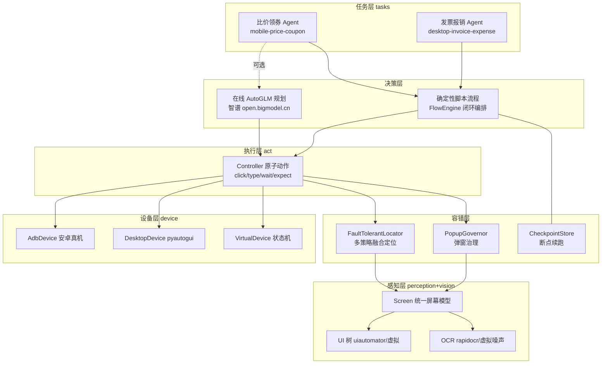
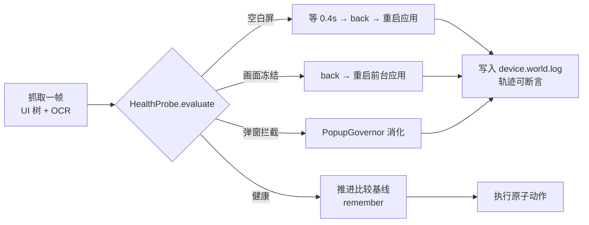

# AutoGLM 端侧智能体 · 架构与技术方案

> 智谱 AI · 2026 AutoGLM 手机与桌面端侧智能体共创挑战赛 参赛工程

## 1. 一句话定位

基于 AutoGLM 决策闭环思想，构建「**多通道容错定位 + 屏幕健康自愈 + 可续跑业务流引擎**」的端侧 GUI 自动化框架，交付三条真实高频痛点闭环：**手机端跨平台比价领券**、**桌面端发票归集报销填单**、**手机端政务 App 会话重登与余额取证**。

## 2. 总体架构



## 3. 高容错元素定位（核心算法）

单一 `text` 选择器在真实 App 上极其脆弱：文案 A/B、分辨率适配、弹窗遮挡、OCR 误识。定位引擎按**成本从低到高**跑多通道策略并做置信度融合：

| 通道 | 来源 | 置信度 | 作用 |
|---|---|---|---|
| `ui:rid` | resource-id 精确 | 0.97 | 版本稳定的锚点 |
| `ui:text` | UI 树文本精确/包含 | 0.85–0.98 | 主通道 |
| `ui:desc` | content-desc | 0.82 | 图标按钮兜底 |
| `ocr` | OCR 精确/包含/编辑距离模糊 | 0.52–0.94 | 无 UI 树页面（游戏/视频/桌面） |
| `template` | 图像模板匹配（OpenCV / 零依赖锚点表） | ≤0.72 | 自绘控件、纯图标按钮，无文本也无节点 |
| `prior` | 归一化坐标先验 | 0.52 | 所有通道失效时的最后救济 |

关键机制：

1. **文本归一化**：NFKC + 全半角折叠 + 去空白 + 小写，吸收「立 即领 取」「立即领取 」类 OCR/字体噪声。
2. **歧义二次确认**：top1 与 top2 置信差 < 0.06 时重采样一帧，要求中心点位移 < 24px 才信任，防止点错相邻卡片。
3. **多通道共识加分**：同一位置被 ≥2 个独立通道命中（例：UI 树文本 + OCR 同时看见「搜索」）时 +0.015，体现"看得见且点得到"的双重证据；单通道不享受此加分。
4. **兜底通道严格门控**：`template`/`prior` 置信度低于 0.7，`FaultTolerantLocator.find()` 默认**不返回**它们；只有 `locate()` 超时后才通过 `allow_fallback=True` 放行，杜绝"低置信候选冒充命中"导致的静默误点。
5. **动作前重校验**：定位与点击之间存在时间窗（弹窗、动画、重排），`Controller._confirm_target()` 在点击前重新采样，要求 `element_key` 一致或中心点位移 < 12px 且形状差异 < 40%，不符则重新定位。
6. **滚动探测**：目标不在首屏时自动向下翻页探测（签名去重防死循环），探测失败回滚到顶；探测预算按调用次数受控，避免无限循环里重复空扫。
7. **分辨率无关**：元素规格可用 0–1 归一化先验描述，不同分辨率（720p→3200p 已验证）自动缩放；UI 树坐标天然按设备像素给出。

## 3.5 屏幕健康自愈闭环（新增）

端侧自动化真正的杀手不是"某步没找到元素"，而是**静默的坏帧**：应用没渲染完的黑白屏、ANR/后台残留导致的画面冻结、把点击吃掉的弹窗。三者都会让后续步骤在错误前提下继续执行，最终表现为"跑完了但结果错"——这是打榜实测成功率最大的隐性漏斗。

`perception/health.py` 把"这一帧能不能信"变成可度量信号，`guard/watchdog.py` 负责处置：



设计要点：

- **健康度评分**：基础 1.0，空白屏 −0.45、画面冻结 −0.3、弹窗拦截 −0.25，元素/文本稀薄再小幅扣分，每项都给出中文原因（供录屏讲解与轨迹留证）。
- **冻结的判据是「动作前后配对」**：`Controller._act_with_watchdog()` 在动作前抓一帧、动作后再抓一帧，同签名才判为冻结。若改成"两次体检之间比较"，任何静止的正常页面（等待页、结果页）都会被误判为冻结，进而触发破坏性的 `back`/重启——这是本框架开发过程中实际踩到并修正的坑，并固化成回归用例 `test_healthy_static_page_is_not_flagged_as_frozen`。
- **动作前只做预防性检查**：`Watchdog.check()` 不做冻结判定，只拦截「动作前就能看出」的故障（弹窗遮挡、空白屏）；冻结与卡死交给动作后校验。
- **双签名比较**：屏幕签名含坐标（识别"同内容换位置"的重绘），文本签名只含文本（抗像素漂移判断"页面到底变没变"）。
- **升级节奏**：第 1 次故障 `back()` 打破僵局；累计 ≥2 次故障且已知前台应用时 `launch(last_app)` 重启应用。累计计数 `_recent_faults` 与比较基线解耦——否则 `back()` 改变了画面会把计数一起清零，升级路径永远走不到。
- **自愈动作可断言**：每次处置都写 `device.world["log"]`，使自愈行为可被单测验证、可被录屏展示。
- **保守优先**：阈值高于单帧噪声（正常页面的元素密度低也会扣分，但不会触发处置），宁可漏处置也不误操作。

## 3.6 视觉多后端一致性（新增）

单一视觉通道的结果不得被当成事实——OCR 识别错一个字，仍会以 0.86 的置信度被采信。

- `OcrConsensus`：包装多个 OCR 后端，同一文本被 ≥2 路同时读出才给满分，单路命中打 0.85 折，交由定位层二次确认；单后端异常只降级为"其余后端结果"，不中断感知。
- `VisionConsistency`：登记各后端（虚拟 JSON OCR / 模板匹配）对同一目标的结论，中心点曼哈顿距离 < 0.06 或分数差 < 0.12 视为互相印证；只存帧摘要哈希，不驻留图像字节。
- `OcrConsistency`：连续多帧「同一画面且始终零命中」判定为"该页面确实无文本"（纯图标/自绘界面），避免定位层空等 OCR。

## 3.7 输入动作的静默失败防护（新增）

`type_text` 最危险的失败形态不是报错，而是**静默写入失败**（输入法未就绪、框未聚焦、内容被系统清空）。`Controller.type_text` 因此改为：

1. tap 聚焦 → 定位后重校验 → clear → 输入；
2. **回读校验**：从世界状态（虚拟设备）/ 输入框 key（真机）/ 屏幕文本三层依次解析实际内容；
3. 空回读不等于成功：用屏幕是否含期望值区分"设备无可读状态"与"内容真的没写进去"；
4. 校验失败则重新定位并重键入，最多 `settings.action_max_verify` 轮，全失败抛 `LocateError`（不静默放过）。

## 4. 业务闭环流程引擎

`Flow = [Step]`，每个 Step 是「act（动作）+ verify（业务校验）」二元组，**校验不通过视同失败**——这是"闭环"的定义：不信任"点了就算完成"。

- 失败策略：`retry`（指数退避）→ `recover_back`（回退恢复现场）→ `fallback`（降级路径，如 OCR-only 定位再提交一次）→ `skip`/`abort`。
- 非关键步骤（如交叉校验、附件上传）失败降级为 skipped，不打断主链路。
- 每步成功后写 `CheckpointStore`（原子 replace），进程崩溃/设备掉线后 `resume=True` 从断点继续，上下文 `ctx` 一并恢复。

### 场景一：手机端跨平台比价领券（闭环步骤）

启动 A 商城（治理开屏广告）→ 搜索 → 滚动采集全部到手价 → 切 B 商城同款比价 → 切领券 App（自动处理剪贴板权限弹窗）→ 领取品类券 → 读券后价 → 输出最低到手价购买建议（JSON 产物）。

### 场景二：桌面端发票归集报销（闭环步骤）

打开企业邮箱（治理升级弹窗）→ 逐张识别发票金额（OCR 噪声去重 + 与"合计"行对账）→ 打开财务系统 → 填申报人/事由/金额 → 传附件 → 提交（降级：rid/先验坐标重试）→ 回读报销单号产出回执。

### 场景三：手机端政务 App 会话重登与余额取证（闭环步骤）

政务/银行类 App 的真实高频痛点：打开必弹权限/协议弹窗、会话过期需重新登录、登录还要收一次短信验证码——链条长、外部依赖多、人工每天重复。

启动政务通（治理开屏广告 → 权限弹窗）→ 会话过期重登（手机号 → 获取验证码 → OTP → 提交）→ 进入公积金查询并解析余额 → 采集可审计证据（金额 + 屏幕文本快照）→ 落盘 `auth_report.json`。

该场景覆盖另外两条闭环没有的三条容错链路：

- **OTP 挑战与输入回读**：验证码输入框带 OCR 噪声，必须靠回读校验保证 6 位码真的写进去了；
- **登录态分流**：同一入口按 `logged_in` 决定进办事大厅还是走验证码挑战（`Effect.goto_if`），证明流程不是硬编码顺序；会话仍有效时 `login` 直接复用（`login: reused-session`）；
- **错误验证码不放行**：验证码不匹配时页面停留、登录态不置位，由步骤校验捕获并重试。

## 4.5 异常自愈能力矩阵（新增）

下表每一行都有自动化用例（`tests/test_resilience.py`，13 例）或演示开关（`--chaos`）作为证据：

| 故障类型 | 检测手段 | 处置动作 | 证据 |
|---|---|---|---|
| 开屏广告 / 升级弹窗 | `PopupGovernor` 特征词 + 关闭词表 | 点关闭/跳过，循环至干净 | `test_ad_popup_consumed_before_business_steps` |
| 权限弹窗（剪贴板/定位） | 弹窗特征词（"想要…权限"） | 仅在含权限特征时点「允许」 | `test_watchdog_dismisses_popup_and_logs_action` |
| **步骤执行后才弹窗** | 下一步动作前 `Controller.watch()` | 体检发现 pending 弹窗并消化 | `test_popup_after_arbitrary_step_is_absorbed` |
| UI 元素漂移 | 多通道定位 + 歧义二次确认 | 重新采样确认中心稳定后点击 | `test_ui_drift_and_ocr_noise_still_locates`（720p/1080p/1440p × 12–24px） |
| OCR 噪声/错字 | 文本归一化 + 编辑距离 + 多后端共识 | 低置信候选降权，由 `ui:` 通道裁决 | `test_fuzzy_ocr_recovers_noisy_text` |
| 输入被清空/未写入 | `type_text` 回读校验 | 重新定位 + 重键入（≤ `action_max_verify` 轮） | `test_cleared_field_is_retyped_and_verified`、`--chaos` |
| 黑屏/白屏（未渲染） | 元素与文本双空 → `blank` | 等 0.4s → back → 重启应用 | `test_blank_and_frozen_frames_are_flagged` |
| 画面冻结/卡死（ANR、点击被吃掉） | 动作**前后**签名完全相同 → `frozen` | back 打破僵局 → 累计 2 次重启前台应用 | `test_stalled_action_escalates_from_back_to_app_restart` |
| 静止的正常页面被误判为冻结 | 健康页面多次体检不得产生处置 | —（不处置） | `test_healthy_static_page_is_not_flagged_as_frozen` |
| 目标不在首屏 | 滚动探测（签名去重防死循环） | 自动翻页 + 失败回滚到顶 | 折叠区场景 + `LocateError` 用例 |
| 关键步骤持续失败 | 每步 `verify` 业务校验 | 指数退避重试 → `recover_back` → `fallback` → 落检查点中止 | `test_critical_failure_keeps_checkpoint_then_resumes` |
| 进程崩溃/设备掉线 | `CheckpointStore` 原子落盘 | `resume=True` 断点续跑，`ctx` 一并恢复 | `test_critical_failure_keeps_checkpoint_then_resumes` |
| 真机缺失（无 adb/pyautogui） | 设备层异常归一为 `DeviceError` | 回落虚拟设备 / `NullDesktopBackend`，控制流照跑 | `run_demo.py` 真机分支 |

## 5. AutoGLM SDK 接入方式

- `agent/client.py` 按智谱开放平台 Chat Completions 协议封装（`ZHIPU_API_KEY` / `ZHIPU_BASE_URL` / `AUTOGLM_MODEL` 环境变量），把屏幕元素渲染为紧凑文本视图交给模型，模型输出受限 JSON 动作集（tap/type/swipe/launch/back/wait/done/fail），由 `AutonomousRunner` 翻译为容错原子动作，并用"连续 3 帧无变化自动 back"防卡死。
- 无 Key / 断网时自动回落到确定性脚本闭环（演示与打榜环境永远可跑），符合 RULES.md「实测成功率优先」的评分导向。

## 6. 技术选型理由

| 选型 | 理由 |
|---|---|
| Python 标准库为核 | 评审/CI 环境零依赖可跑（`run_demo.py` 直接出结果），可选栈（rapidocr/pyautogui）延迟导入自动降级 |
| UI 树优先于视觉 | uiautomator dump 便宜、稳定、无模型成本；OCR/模板仅在无树场景启用 |
| 状态机虚拟设备 | 把"UI 漂移、弹窗、OCR 噪声、折叠区"变成可编程注入的测试变量，容错能力可被单测证明而非口述 |
| 检查点 + 校验闭环 | 端侧自动化最大成本是"跑到 80% 挂了重头再来"，断点续跑 + 每步 verify 直接决定打榜实测成功率 |

## 7. 目录结构

```text
src/
├── run_demo.py                 # 一键入口（虚拟演示 / --chaos 故障注入 / --trace 轨迹导出 / 真机 / --agent 在线规划）
├── requirements.txt            # 全部可选增强依赖
├── Dockerfile
├── autoglm_agent/
│   ├── config.py               # 环境变量与运行参数（含 action_max_verify / blank_settle / scroll_settle）
│   ├── device/                 # base(+DeviceError) / adb(真机,wait_boot/降级) / desktop(pyautogui+Null 降级) / virtual(状态机)
│   ├── vision/                 # ocr(rapidocr/虚拟噪声/OcrConsensus 多后端投票) + base(模板契约)
│   │                           #   + template(锚点模板/OpenCV 匹配) + consistency(跨后端互证) + annotate(证据帧叠加)
│   ├── perception/             # screen(统一屏幕模型+归一化) + health(健康度探针:空白/冻结/弹窗)
│   ├── locate/                 # ElementSpec / 多策略(ui/ocr/template/prior) / FaultTolerantLocator
│   ├── guard/                  # popup(PopupGovernor 弹窗治理) + watchdog(自愈看门狗)
│   ├── act/                    # Controller 容错原子动作(动作前体检+重校验+输入回读)
│   ├── memory/                 # checkpoint(断点续跑) + trace(执行轨迹留证)
│   ├── flow/                   # Step/Flow/FlowEngine 闭环编排
│   ├── agent/                  # AutoGLM 在线规划接入 + 自主执行器
│   └── tasks/                  # 三大业务闭环 + 演示场景剧本（含 gov_auth 场景）
└── tests/                      # 30 个用例：定位容错/弹窗/健康自愈/重试降级/断点续跑/异常注入/三条闭环
```

## 8. 快速开始

```bash
cd src
python3 run_demo.py                                  # 离线三条闭环演示（推荐评审路径，零依赖）
python3 run_demo.py --chaos --trace trace.md         # 故障注入 + 导出执行轨迹（稳定性证据）
python3 -m pytest tests -q                            # 30 个用例：容错/自愈/续跑/异常注入/三条闭环
DEVICE=adb python3 run_demo.py                        # 安卓真机（缺设备自动回落虚拟，不中断演示）
DEVICE=desktop python3 run_demo.py                    # 桌面端（缺 pyautogui 自动降级并明确提示）
ZHIPU_API_KEY=sk-xxx python3 run_demo.py --agent "帮我比价买最便宜的蓝牙耳机"
```

环境变量（全部可选，带默认值）：`LOCATE_TIMEOUT`、`LOCATE_POLL`、`LOCATE_MAX_SCROLL`、
`ACTION_MAX_VERIFY`（输入回读重试轮数）、`BLANK_SETTLE`、`FLOW_MAX_RETRIES`、`CHAOS`。

## 9. 测试与复现

| 命令 | 覆盖 | 预期 |
|---|---|---|
| `python3 -m pytest tests -q` | 全部 30 例 | `30 passed` |
| `python3 run_demo.py` | 三条闭环端到端 | 末行 `结果: 全部闭环通过 ✅`，产物 3 份 JSON |
| `python3 run_demo.py --chaos` | 漂移 20px + 输入被清空 + 模板通道 | 仍 `全部闭环通过 ✅`，日志含 `[chaos] 已注入` |
| `python3 run_demo.py --chaos --trace trace.md` | 轨迹留证 | 生成 md 表格，含通道/置信度/自愈次数/健康度 |

用例分布：

- `tests/test_locator.py`：归一化、多通道优先级、rid/editable 过滤、prior 兜底、模糊 OCR 恢复、三种分辨率 × 漂移定位、弹窗治理无误伤。
- `tests/test_flow.py`：重试后关键步骤中止流程、检查点续跑、两条业务闭环端到端。
- `tests/test_resilience.py`：异常注入（弹窗/漂移/输入被清空/关键步骤失败续跑/步骤后弹窗）、健康度与自愈（空白/冻结/升级重启）、政务闭环（OTP 成功/错误码不放行/会话复用）。
