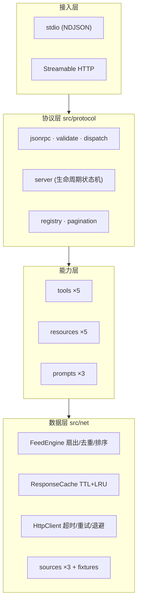

# NetIntel — MCP Server for Open-Source Intelligence

> **DoraHacks · Anna AI App Builder Program**（智能体与 MCP Server 专项扶持）
> 赛事 ID `dorahacks-anna-ai-agent-2026` · 交付截止 `2026-11-30`

把 Hacker News、GitHub、arXiv 三个异构数据源，收敛成**一层可排序、可去重、可缓存、可离线复现**的
技术情报流，通过 [Model Context Protocol](https://modelcontextprotocol.io) `2025-06-18` 标准协议
暴露给任意 MCP 客户端（Claude Desktop / Cursor / Windsurf / Anna AI OS / 自研 Agent）。

```
5 tools · 5 resources (2 templates) · 3 prompts · 3 sources · 0 runtime dependencies · 手写 JSON-RPC 2.0
```

---

## 为什么值得接入

| 痛点 | 现有做法 | NetIntel |
|---|---|---|
| 每个数据源一套解析胶水 | N 个 server，N 套错误处理 | 单一 `net_search`，三源并发扇出 |
| 返回噪声塞满上下文 | 上游原始 JSON 直接投喂 | 相关性 4.0 + 时效性 2.0 + 热度 1.0 加权排序，URL 归一化去重 |
| 单源挂掉整个调用失败 | 抛错，Agent 只能重试 | `partial:true` + `failedSources[]`，降级信息对模型可见 |
| 上游限流打爆 | 每次调用都直连 | 确定性缓存键（FNV-1a 64）+ TTL + LRU，`net_cache` 可观测 |
| 演示/评测不可复现 | 依赖真实网络 | `NETINTEL_OFFLINE=1` 全部走 `fixtures/feeds/**` 回放 |
| 依赖树膨胀、弱网装不上 | `npm i` 拉几百个包 | **`"dependencies": {}`**，只编译 `typescript` |

---

## 60 秒跑通

```bash
git clone <repo> && cd 17_dorahacks-anna-ai-mcp
npm ci                # 只有 typescript + @types/node
npm run build         # tsc → dist/
npm test              # 全套 JSON-RPC 一致性 / 错误矩阵 / fuzz / 传输测试
npm run smoke         # 对真实子进程跑完整协议会话，打印逐步 PASS 表
```

期望末行：

```
SMOKE OK (17 steps)
```

一条命令验收全部：`npm run verify`（typecheck → lint → build → test → smoke）

---

## 接入

### Claude Desktop / Cursor / Windsurf

```json
{
  "mcpServers": {
    "netintel": {
      "command": "node",
      "args": ["/绝对路径/17_dorahacks-anna-ai-mcp/dist/src/cli.js", "--transport", "stdio"]
    }
  }
}
```

完整样例（含离线模式）见 [`mcp.json.example`](mcp.json.example)。

### Docker（可做在线体验链接）

```bash
docker build -t netintel-mcp:0.1.0 .
docker compose up -d netintel-mcp                    # HTTP 模式，127.0.0.1:8765
docker compose --profile verify run --rm netintel-smoke   # 容器内自证
```

### 手动验证 JSON-RPC

```bash
printf '%s\n' \
 '{"jsonrpc":"2.0","id":1,"method":"initialize","params":{"protocolVersion":"2025-06-18","capabilities":{},"clientInfo":{"name":"c","version":"1"}}}' \
 '{"jsonrpc":"2.0","method":"notifications/initialized"}' \
 '{"jsonrpc":"2.0","id":2,"method":"tools/call","params":{"name":"net_search","arguments":{"query":"mcp server","limit":3}}}' \
 | node dist/src/cli.js --transport stdio
```

详见 [`docs/QUICKSTART.md`](docs/QUICKSTART.md)（含故障排查表）。

---

## 能力一览

### 工具 (5)

| 工具 | 说明 |
|---|---|
| `net_search` | 跨源检索 + 扇出 + 去重 + 排序，返回结构化情报流（`total` 为截断前总数） |
| `net_digest` | 给定时间窗（1–168h）生成固定骨架的 Markdown 简报 |
| `net_fetch` | 抓取单页并清洗为纯文本 / Markdown，可限字节、可截断标记 |
| `net_sources` | 各数据源可用性与最近错误、缓存配置 |
| `net_cache` | `stats` / `clear` / `purge` 三个动作，缓存行为可观测 |

全部声明 `outputSchema` 且返回 `structuredContent` + 镜像 text block（MCP 向后兼容要求）。

### 资源 (3 静态 + 2 模板)

`netintel://catalog` · `netintel://sources` · `netintel://cache/stats` ·
`netintel://feed/{key}` · `netintel://item/{source}/{id}`

订阅 `netintel://feed/{key}` 后，任何写入同一缓存键的调用都会触发
`notifications/resources/updated`。

### 提示词 (3)

`brief_topic` · `compare_sources` · `explain_item`，并支持 `completion/complete`
对 `sources` / `lookback_hours` / feed key 做前缀补全。

---

## 架构



- 业务流程图、排序公式推导、13 项技术选型对照（含被否方案）：[`docs/ARCHITECTURE.md`](docs/ARCHITECTURE.md)
- MCP 规范逐条对照 + **3 处主动声明的偏差**：[`docs/PROTOCOL-COMPLIANCE.md`](docs/PROTOCOL-COMPLIANCE.md)
- 全部工具 / 资源 / 提示词 / 错误码的逐字节样例：[`docs/INTERFACES.md`](docs/INTERFACES.md)
- 演示视频分镜与旁白：[`docs/DEMO-SCRIPT.md`](docs/DEMO-SCRIPT.md)
- 提交材料对照表：[`docs/SUBMISSION-CHECKLIST.md`](docs/SUBMISSION-CHECKLIST.md)

---

## 配置

| 变量 | 默认 | 说明 |
|---|---|---|
| `NETINTEL_TRANSPORT` | `stdio` | `stdio` \| `http` |
| `NETINTEL_HOST` / `NETINTEL_PORT` | `127.0.0.1` / `8765` | HTTP 绑定地址与端口 |
| `NETINTEL_OFFLINE` | `0` | `1` = 只读 fixtures，零网络请求 |
| `NETINTEL_FIXTURE_DIR` | `<repo>/fixtures/feeds` | fixture 根目录 |
| `NETINTEL_CACHE_TTL_MS` / `NETINTEL_CACHE_MAX` | `300000` / `256` | 缓存 TTL 与 LRU 上限 |
| `NETINTEL_TIMEOUT_MS` | `8000` | 单次上游请求超时 |
| `NETINTEL_LOG_LEVEL` | `info` | syslog 八级 |
| `NETINTEL_TOKEN` | 未设置 | 设置后 HTTP 强制 `Authorization: Bearer` |
| `NETINTEL_ALLOW_ANY_ORIGIN` | `0` | `1` = 关闭 Origin 白名单 |

---

## 工程约束（被测试与静态门禁强制）

- **零运行时依赖**：`dependencies` 恒为 `{}`。
- **stdout 纯净**：`scripts/lint.js` 规则 L1/L2 禁止 `src/` 内任何 `console.*` 与 `process.stdout`
  （唯一白名单是 `src/transports/stdio.ts`），保证 stdio 传输不会污染协议流。
- **无 `any`、无 `@ts-ignore`、无未完成占位**：lint 规则 L3/L5/L6。
- **离线可复现是强制的**：测试在 `NETINTEL_OFFLINE=1` 下运行，且 `fetchImpl` 被替换为
  **抛错实现**——任何意外的网络访问都会让测试立即失败，而不是碰巧通过。
- **确定性**：注入时钟 + 固定种子 PRNG + 稳定全序排序，同一输入两次调用输出逐字节一致。

---

## 目录

```text
├── src/
│   ├── protocol/     协议内核（信封解码、分发表、状态机、注册表、分页）
│   ├── net/          HTTP 客户端、缓存、FeedEngine、XML 读取器、三源适配器
│   ├── tools/        5 个工具 + 零依赖 JSON Schema 子集校验
│   ├── resources/    3 静态资源 + 2 模板 + 订阅中心
│   ├── prompts/      3 个提示词 + 补全
│   ├── transports/   stdio | http
│   ├── config.ts     环境变量 / 命令行 → 配置
│   ├── index.ts      依赖注入组装根
│   └── cli.ts        可执行入口
├── tests/            JSON-RPC 一致性 / 错误矩阵 / fuzz / 传输
├── fixtures/feeds/   离线回放数据（保存上游原始报文，解析路径与线上一致）
├── scripts/          lint.js（静态门禁）· smoke.js（一键端到端证明）
└── docs/             架构 · 协议一致性 · 接口规范 · 演示脚本 · 提交清单
```

---

## License

MIT
