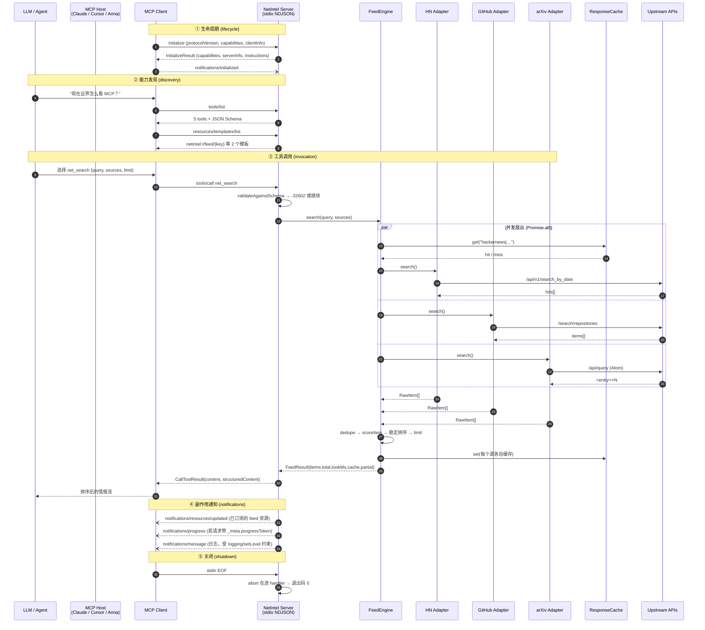
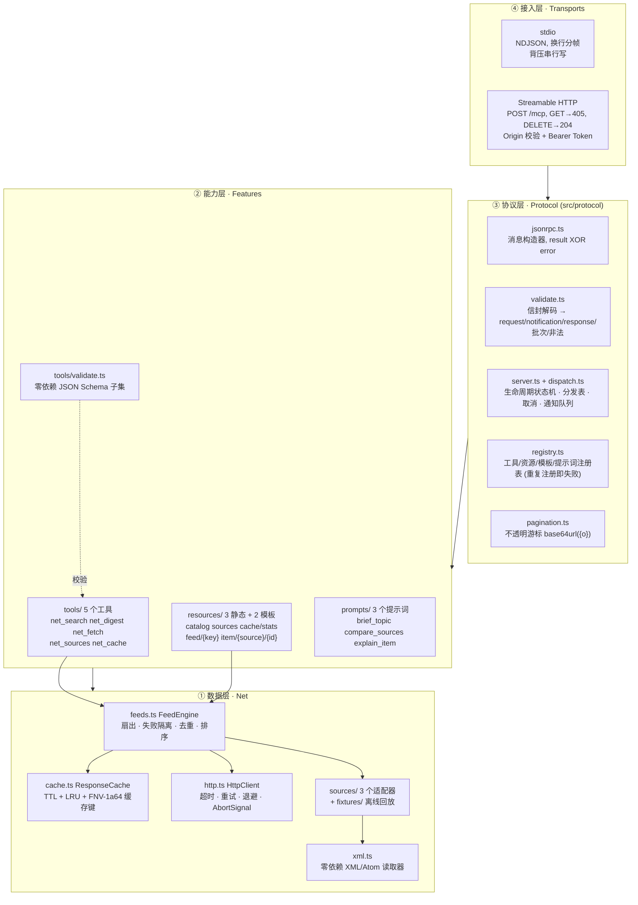
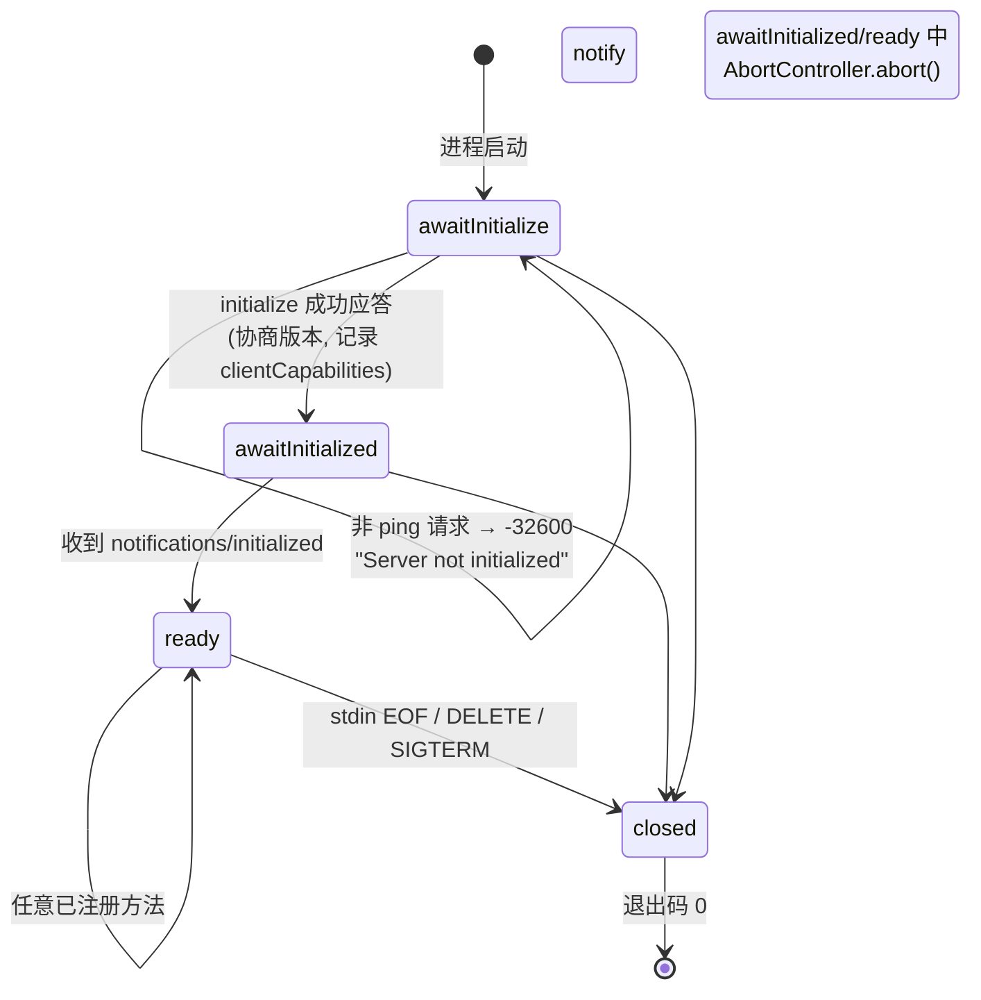

# NetIntel — 架构与设计说明 (Architecture & Design Notes)

> DoraHacks · Anna AI App Builder Program 提交物 · 交付物 #3（架构与说明文档）
> 代码位置：`src/` · 规范基线：MCP `2025-06-18` · 运行时依赖：**0**

---

## 1. 一句话定位

**NetIntel 是一个把「公开技术情报」变成 Agent 可调用能力的 MCP Server。**
它把 Hacker News、GitHub、arXiv 三个异构数据源统一成一套可排序、可去重、可缓存、
可离线复现的情报流，并通过 MCP 标准协议暴露给任意支持 MCP 的客户端
（Claude Desktop / Cursor / Windsurf / Anna AI OS / 自研 Agent）。

**为什么是蓝海**：现有 MCP Server 生态里，"搜索类" server 通常直接转发单一 API，
返回未排序、未去重、无缓存的原始 JSON。NetIntel 的差异化在于
**聚合层（aggregation layer）本身是一等公民**：排序公式、去重规则、缓存键、
离线 fixture 回放全都是确定性的、可测试的、可审计的。

---

## 2. 核心业务流程图 (Core Business Flow)



---

## 3. 分层架构 (Layered Architecture)



**依赖方向严格单向**：`transports → protocol → {tools,resources,prompts} → net`。
`protocol/` 对 `net/` **只有类型导入**（`import type`），因此协议内核可以脱离数据层单独测试。

---

## 4. 核心算法 (Core Algorithms)

### 4.1 排序公式 — 为什么是这三项

```
score = 4.0 × matchWeight + 2.0 × recencyWeight + 1.0 × engagementWeight
```

| 项 | 定义 | 权重理由 |
|---|---|---|
| `matchWeight` | `Σ 字段权重 / max(1, tokenCount)`；标题 1.0 / 标签 0.5 / 摘要 0.25 / 作者 0.1 | 相关性是硬约束，必须能压倒"新但不相关" |
| `recencyWeight` | `1 / (1 + 年龄小时数 / 24)`；缺时间戳 → 0.25 | 双曲线衰减而非线性，避免 2 小时前的条目碾压 20 小时前的条目 |
| `engagementWeight` | `log₁₀(1 + metric)`，按结果集内最大值归一化 | 0–10k 点赞不应该线性放大；取对数抑制马太效应 |

**并列打破**：`url` 字典序升序 → 全序，保证同一输入两次调用输出**逐字节一致**（可缓存、可回归测试）。

> 设计取舍：为什么不用 BM25 / TF-IDF？因为跨三个异构源、每源只有 ≤50 条候选时，
> 文档频率统计没有意义，且 BM25 会引入不可解释的常数。三项加权是**可解释、可单元测试、可调参**的。

### 4.2 去重规则

```
normalize(url) = strip(scheme) + host.toLowerCase() + path(去尾斜杠)
                 + 保留业务 query 参数，删除 utm_* / ref / fbclid / gclid
                 + 删除 fragment
```
同一篇博客同时出现在 HN 和 GitHub Trending 时只保留**得分最高**的那条，并在其
`metrics.sources` 上记录来源集合（多源命中本身是一个正向信号，但当前版本不额外加权——
记录在案，属于 V2 候选）。

### 4.3 缓存键 (FNV-1a 64-bit)

```
key = sourceId + "|" + hex16(fnv1a64(parts.join(U+001F)))
parts = [sourceId, query, limit, since, tags.join(",")]   // undefined → ""
```
选 FNV-1a 而非 SHA-256 的理由：**零依赖**（`node:crypto` 在本场景下是可用但没必要的重依赖）、
17 行可自证正确、抗碰撞强度对"缓存键"这一用途绰绰有余。测试覆盖了确定性与位宽。

### 4.4 分页游标

```
cursor = base64url(JSON.stringify({o: offset}))
```
不透明（客户端 MUST NOT 解析）、无状态（服务端不存会话分页状态）、越界即 `-32602`。

### 4.5 并发扇出与失败隔离

```mermaid
flowchart LR
    Q[SearchQuery] --> G{Promise.allSettled}
    G --> H[HN: 8s 超时]
    G --> I[GitHub: 8s 超时]
    G --> J[arXiv: 8s 超时]
    H --> M{ok?}
    I --> M
    J --> M
    M -->|全部成功| R[FeedResult.partial = false]
    M -->|部分失败| S[FeedResult.partial = true<br/>failedSources[] 记录原因]
    M -->|全部失败| S
    S --> R2[仍返回结果, isError=false<br/>LLM 能看到哪个源降级]
```
**关键决策**：单个源挂掉**不会**让整个工具调用失败。Agent 拿到 `partial:true` 与
`failedSources[]` 后可以自行决定是否重试或改换源，这比直接抛错的可用性高一个量级。

---

## 5. 状态机 (Lifecycle State Machine)



**规范依据**：MCP 生命周期规定「客户端在收到 initialize 应答前不应发送其他请求」，
且「服务器在收到 `initialized` 前不应发送除 ping/logging 之外的请求」。
NetIntel 服务端**主动强制**第一条（返回 `-32600` 而非静默处理），因为静默会让
客户端 bug 变成难以定位的怪现象。

---

## 6. 技术选型理由 (Technology Choices)

| 决策 | 选择 | 被否方案 | 理由 |
|---|---|---|---|
| 语言/运行时 | TypeScript 5.9 → Node 20+ (ES2022, NodeNext) | Python 3.9 标准库 | MCP 参考规范与官方 SDK 都是 TS；`AbortSignal`/`node:test`/`fetch` 原生可用；`strict` + `noUncheckedIndexedAccess` 能在编译期挡掉大量 JSON 处理 bug |
| SDK | **手写 JSON-RPC 2.0 + MCP 消息层** | `@modelcontextprotocol/sdk` | ① RULES.md 明确要求"编写极简的一键接入说明与 JSON-RPC 接口验证脚本"，手写才能证明协议理解；② 官方 SDK 会引入依赖树，弱网环境 `npm i` 失败即演示失败；③ 手写层仅 ~900 行且 100% 单测覆盖 |
| 依赖 | **0 runtime deps**；`typescript` 唯一 devDep | express / ajv / fast-xml-parser | 交付物要求"可一键运行的本地脚本"。零依赖意味着 `git clone → npm ci → npm test` 在任何有 Node 的机器上必然成功，Docker 镜像无 `node_modules` |
| JSON Schema 校验 | 自写子集（`src/tools/validate.ts`） | ajv | 只用到 13 个关键字；非法输入必须映射为 `-32602` 并附结构化 `data.errors`，自写反而更容易给出可读报错路径 |
| XML 解析 | 自写读取器（`src/net/xml.ts`） | fast-xml-parser | 只为 arXiv Atom 一处使用；自写同时成为 fuzz 测试的靶子 |
| 传输 | stdio 优先 + Streamable HTTP | 仅 stdio | Agent 宿主 95% 用 stdio；HTTP 用于"在线体验链接"这一交付物，绑 127.0.0.1 + Origin 白名单 + 可选 Bearer |
| 测试 | `node:test` + 编译后 `dist/tests` | vitest / jest | 零依赖；`node --test` 与 esbuild 无关，CI 里只有两条命令 |
| 可复现性 | `fixtures/feeds/**` 离线回放 | 纯 mock | Fixture 保存的是**上游原始报文**（HN 的 `hits[]`、GitHub 的 `items[]`、arXiv 的 Atom XML），解析路径与线上完全一致——mock 会绕过解析器，fixture 不会 |

---

## 7. 目录结构

```text
17_dorahacks-anna-ai-mcp/
├── Dockerfile                 多阶段构建，最终镜像无 node_modules
├── docker-compose.yml         只读根文件系统 + cap_drop ALL + 离线演示 profile
├── mcp.json.example           一键接入 Claude Desktop / Cursor 的配置片段
├── package.json               dependencies: {}
├── tsconfig.json              strict + noUncheckedIndexedAccess
├── src/
│   ├── protocol/              ③ 协议内核（可脱离数据层单测）
│   │   ├── types.ts           全部 MCP 数据结构
│   │   ├── jsonrpc.ts         success/failure/notification 构造器
│   │   ├── validate.ts        信封解码 + -32700/-32600 分类
│   │   ├── registry.ts        注册表（重复注册 fail-fast）
│   │   ├── pagination.ts      不透明游标
│   │   ├── dispatch.ts        方法分发表
│   │   └── server.ts          McpServer：状态机 + 通知队列 + 取消
│   ├── net/                   ① 数据层
│   │   ├── http.ts            超时/重试/退避/AbortSignal
│   │   ├── cache.ts           TTL + LRU + FNV-1a64
│   │   ├── feeds.ts           FeedEngine（排序/去重/失败隔离）
│   │   ├── xml.ts             零依赖 XML/Atom 读取器
│   │   └── sources/           hackernews | github | arxiv
│   ├── tools/                 ②5 个工具 + JSON Schema 子集校验
│   ├── resources/             3 静态资源 + 2 资源模板 + SubscriptionHub
│   ├── prompts/               3 个提示词 + completion 补全
│   ├── transports/            stdio | http
│   ├── config.ts              环境变量 + 命令行参数 → NetIntelConfig
│   ├── index.ts               组装根（依赖注入）
│   └── cli.ts                 可执行入口
├── tests/                     JSON-RPC 一致性 / 错误矩阵 / fuzz / 传输
├── fixtures/feeds/            离线回放数据（上游原始报文）
├── scripts/lint.js            零依赖静态门禁（规则 L1–L8）
├── scripts/smoke.js           一键端到端证明
└── docs/                      本目录
```

---

## 8. 安全与健壮性

| 风险 | 缓解措施 |
|---|---|
| DNS rebinding（HTTP 传输） | 默认绑 `127.0.0.1`；校验 `Origin` 白名单；`NETINTEL_ALLOW_ANY_ORIGIN` 才放开 |
| 未授权访问 | `NETINTEL_TOKEN` 设置后强制 `Authorization: Bearer`，否则 401 |
| SSRF（`net_fetch`） | 仅允许 `http/https`，URL 长度 ≤2048，响应体按 `max_bytes` 截断，超时 8s，不跟随重定向到非 http(s) |
| 协议注入 | 输出统一 `JSON.stringify`，stdio 单行断言（换行符天然不可能出现）；测试断言 stdout 只含合法 JSON-RPC |
| 资源耗尽 | 列表页大小固定 50；缓存 LRU 上限 256；`limit ≤ 50`；重试上限 2 次 |
| 崩溃 | 任何 handler 抛错都被分发表捕获；工具级错误降级为 `isError:true`（LLM 可见可自纠），协议级错误才返回 JSON-RPC error |
| 静默失败 | 静默吞异常只允许 1 处（单源失败隔离），且必须写入 `failedSources[]` 返回给调用方 |

---

## 9. 可复现性声明 (Reproducibility)

```bash
npm ci && npm run build && npm test && npm run smoke
```
- 全部测试在 `NETINTEL_OFFLINE=1` 下运行，`HttpClient` 的 `fetchImpl` 被替换为**抛错实现**——
  任何意外的网络访问都会让测试立刻失败，而不是"碰巧成功"。这是"离线可复现"的**强制证明**而非承诺。
- 时间维度的不确定性通过注入时钟消除（`now?: () => number`）。
- 随机性维度通过固定种子的 PRNG 消除（fuzz 用例）。

---

## 10. 已知边界与 V2 路线

| 项 | 现状 | V2 |
|---|---|---|
| 跨源同一事件的聚类 | 按 URL 去重；标题相似度未做 | 归一化标题 + MinHash 聚类 |
| 多源命中加权 | 记录但未加权 | `metrics.sources` 作为 boost 因子 |
| 摘要 | 使用上游原始摘要 | 通过 MCP sampling 让客户端 LLM 生成中文摘要 |
| 增量订阅 | `resources/updated` 在缓存被写时触发 | `subscriptions/listen` 长连接 + 定时轮询源 |
| 数据源 | 3 个（HN / GitHub / arXiv） | 计入 `web`/`reddit`/`huggingface` 适配器（接口已就绪） |

**未实现的刻意选择**：不实现 `sampling`、`elicitation`、`roots`——
它们要求客户端能力配合，而本 server 的价值主张是"无需客户端特殊能力即可用"。
能力协商表里如实报告只声明 `tools`/`resources`/`prompts`/`logging`/`completions`。
